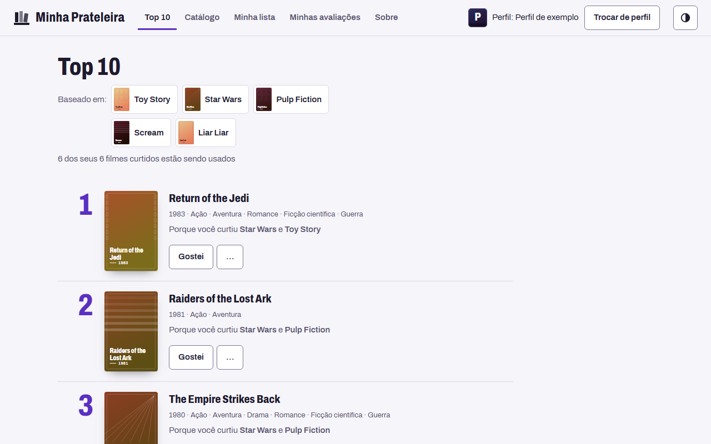
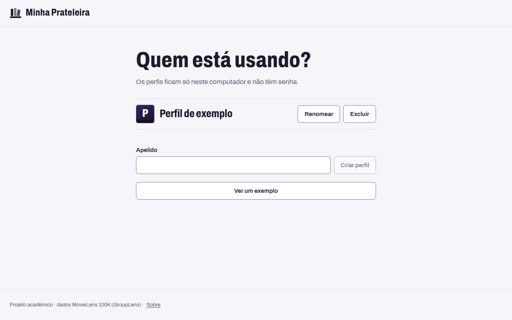
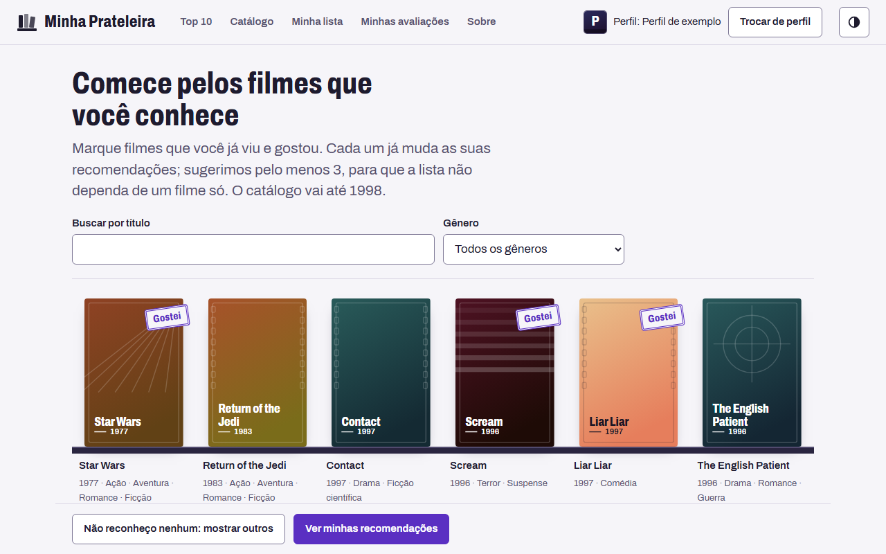
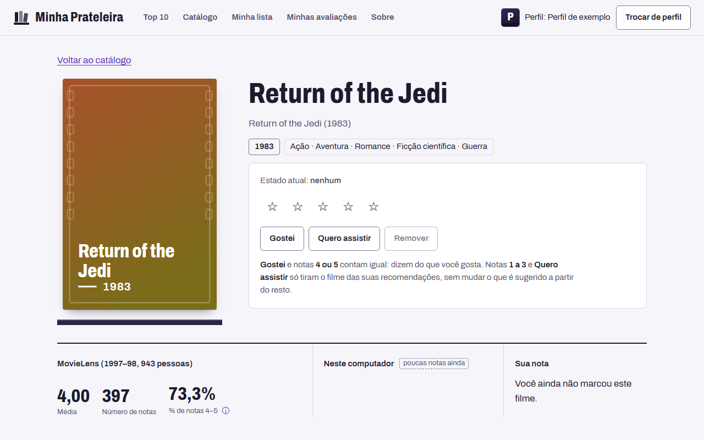
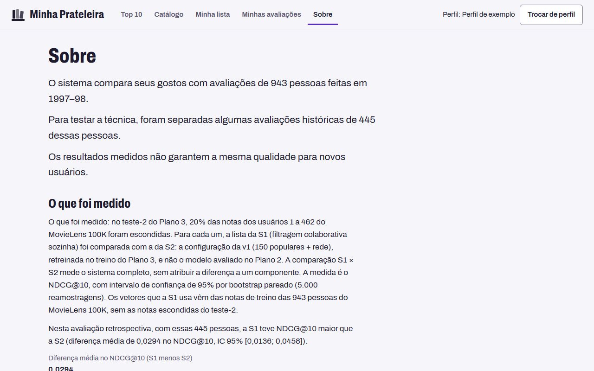

# Recomendação de filmes

Um sistema de recomendação de filmes construído e avaliado passo a passo com o **MovieLens 100K**, **Postgres + pgvector** e **TensorFlow.js**. O projeto tem duas partes:

- **a pesquisa**: três planos de experimentos (vetores de conteúdo, rede neural, filtragem colaborativa), com avaliação pré-registrada e estatística pareada;
- **a aplicação "Minha Prateleira"**: roda no seu computador e recomenda filmes com o sistema vencedor da pesquisa.



<details>
<summary>Mais capturas da aplicação</summary>






As capturas são ilustrativas: perfil de exemplo, agregados e cartazes gerados localmente.
</details>

## Usar a aplicação

Só é preciso ter o **Docker** (Docker Desktop no Windows ou Mac; Docker Engine com Compose v2 no Linux), cerca de 3 GB livres e internet na primeira vez. Não precisa de Node nem de `.env`.

```bash
git clone https://github.com/ergor86/recomendacao-filmes.git
cd recomendacao-filmes/app
docker compose up --build
```

Abra **http://localhost:3000**. A página mostra o progresso da preparação (download dos dados e carga do banco) e abre sozinha quando termina. Nas vezes seguintes, basta `docker compose up` dentro de `app/`.

Porta ocupada, uso sem internet, como apagar tudo e outros problemas comuns: [`app/README.md`](app/README.md).

> Não há site público: a licença do MovieLens 100K não permite redistribuir os dados, e os perfis ficam só na sua máquina. A aplicação publica a porta apenas em `127.0.0.1`; não a exponha na rede (ela não tem senha de perfil).

## Reproduzir a pesquisa

Pré-requisitos: **Git**, **Node.js 22** e **Docker** (o projeto foi desenvolvido com Docker Engine no WSL2 Ubuntu; Docker Desktop com backend WSL2 também funciona).

**1. Docker no WSL2** (uma vez, dentro do Ubuntu):

```bash
curl -fsSL https://get.docker.com | sudo sh
sudo usermod -aG docker $USER
# depois, no PowerShell: wsl --shutdown   (e reabra o Ubuntu)
```

**2. Clonar** (PowerShell, na pasta `C:\dev`; o Node roda no Windows e o WSL2 encaminha a porta 5433):

```powershell
git clone https://github.com/ergor86/recomendacao-filmes.git
cd recomendacao-filmes
```

**3. Criar o `.env`** e editar `PGPASSWORD` antes de subir o banco:

```powershell
cp .env.example .env
```

**4. Subir o banco** (dentro do WSL, na pasta do projeto):

```bash
cd /mnt/c/dev/recomendacao-filmes
docker compose up -d
```

**5. Instalar, baixar os dados e conferir** (de volta no PowerShell):

```powershell
npm install              # o postinstall cuida da tensorflow.dll no Windows
npm run baixar-dados     # MovieLens 100K em data/ml-100k
npm run ambiente         # verifica TensorFlow.js e o banco
npm test                 # testes de unidade
```

A partir daqui, cada plano é uma sequência de scripts numerados (01 a 23). O fluxo explicado está em [Pipeline da pesquisa](docs/guia/03-pipeline-da-pesquisa.md), e os comandos exatos, na ordem em que rodaram, estão no [registro completo](docs/guia/08-registro-completo.md).

## Resultados em resumo

| Plano | Pergunta | Resultado (NDCG@10, diferença média por usuário, IC 95%) |
|---|---|---|
| 1 | Vetores de conteúdo encontram filmes relevantes? | Sozinhos, não (0,070 contra 0,233 da popularidade, na validação) |
| 2 | Uma rede neural reordenando 150 populares supera a popularidade? | **Sim**, no `u1.test`: 0,3526 contra 0,2451; **+0,1076** [0,0907; 0,1250] |
| 3 | Filtragem colaborativa (S1) supera o sistema do Plano 2 (S2)? | **Sim**, no teste-2 retrospectivo: **+0,0294** [0,0136; 0,0458]. A rede sobre a FC ficou abaixo da FC sozinha |

Os resultados vêm de avaliações retrospectivas com usuários históricos e não valem como desempenho com novos usuários. Detalhes e limitações: [Experimentos e decisões](docs/guia/05-experimentos-e-decisoes.md) e [`resultados/README.md`](resultados/README.md).

## Entender o projeto

O **[guia do projeto](docs/guia/README.md)** explica tudo, do básico ao detalhe:

| Capítulo | Conteúdo |
|---|---|
| [1. Visão geral](docs/guia/01-visao-geral.md) | O problema, a linha do tempo dos planos e a arquitetura em duas etapas |
| [2. Mapa do repositório](docs/guia/02-mapa-do-repositorio.md) | O que cada pasta e arquivo faz e como os módulos dependem uns dos outros |
| [3. Pipeline da pesquisa](docs/guia/03-pipeline-da-pesquisa.md) | Fases dos dados e os scripts 01–23: o que cada um lê e grava |
| [4. Fundamentos teóricos](docs/guia/04-fundamentos.md) | Cosseno, pgvector/HNSW, filtragem colaborativa, rede neural, NDCG, bootstrap, vazamento |
| [5. Experimentos e decisões](docs/guia/05-experimentos-e-decisoes.md) | O que foi testado, o que foi escolhido e por quê |
| [6. A aplicação](docs/guia/06-aplicacao.md) | Arquitetura, preparação, cálculo da recomendação, API e telas |
| [7. Glossário](docs/guia/07-glossario.md) | S0–S4, régua, portão, gêmeos, FC150 e outros termos |
| [8. Registro completo da pesquisa](docs/guia/08-registro-completo.md) | Todos os comandos, tabelas e limitações, como registrados durante a pesquisa |

As specs e os planos de implementação estão em [`docs/superpowers/`](docs/superpowers/).

## Estrutura

```
src/         biblioteca da pesquisa        scripts/    scripts 01–23 (npm run …)
tests/       testes da pesquisa            resultados/ números versionados de cada plano
app/         aplicação Minha Prateleira    docs/       guia, specs e planos
```

`data/`, `artefatos/` e `modelos/` são gerados localmente e ficam fora do git.

## Licença e dados de terceiros

| Material | Licença ou termos |
|---|---|
| Código-fonte, testes, scripts e documentação autorais | MIT (arquivo [`LICENSE`](LICENSE)), © 2026 André de Souza Rosa |
| MovieLens 100K | Termos de uso do GroupLens Research (Universidade de Minnesota): uso não comercial, sem redistribuição e com citação, salvo permissão do GroupLens. Os dados não estão no repositório; cada pessoa os baixa do site do GroupLens |
| `resultados/` | Fora da MIT. Resultados científicos publicados para reprodutibilidade, derivados do MovieLens, incluindo métricas por usuário (NDCG@10 por id anônimo de usuário do MovieLens em `avaliacao-final.json` e `avaliacao-v2.json`). Seguem sujeitos aos termos do GroupLens |
| Capturas em `app/docs/capturas/` | Fora da MIT. Mostram títulos, médias agregadas do MovieLens, o perfil de exemplo e cartazes gerados localmente; seguem sujeitas aos termos do GroupLens |
| Fonte Archivo (`app/web/public/fontes/`) | SIL Open Font License 1.1 ([`OFL.txt`](app/web/public/fontes/OFL.txt)) |
| Dependências npm e imagens de contêiner | As licenças de cada pacote e imagem |

A licença MIT do software não autoriza uso comercial, redistribuição nem qualquer outro uso do MovieLens 100K ou de dados derivados dele fora dos termos do GroupLens. Quem usa o código com o MovieLens precisa aceitar e cumprir esses termos por conta própria: https://grouplens.org/datasets/movielens/100k/. Este projeto não é endossado nem apoiado pelo GroupLens nem pela Universidade de Minnesota.

## Dados e citação

Os dados do MovieLens 100K não ficam no repositório. Citação:

F. Maxwell Harper and Joseph A. Konstan. 2015. The MovieLens Datasets: History and Context. ACM TiiS 5, 4, Article 19. DOI: 10.1145/2827872
