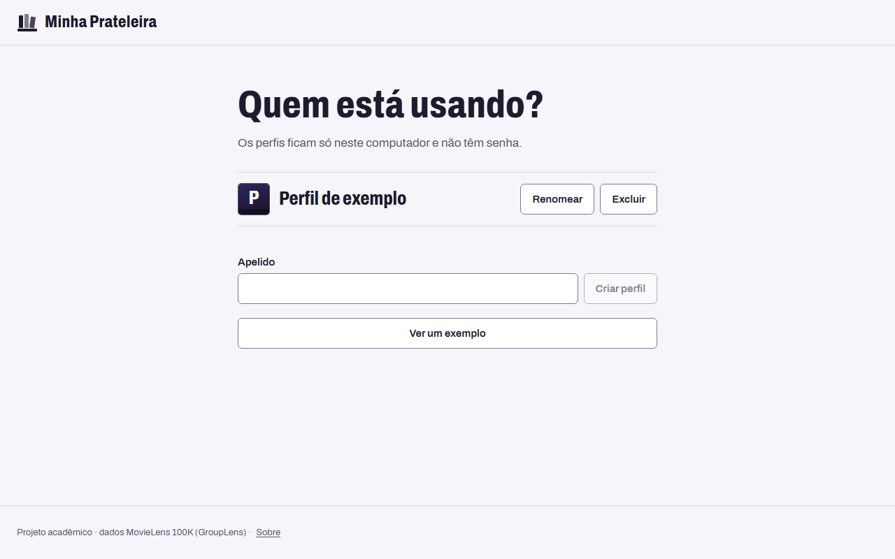
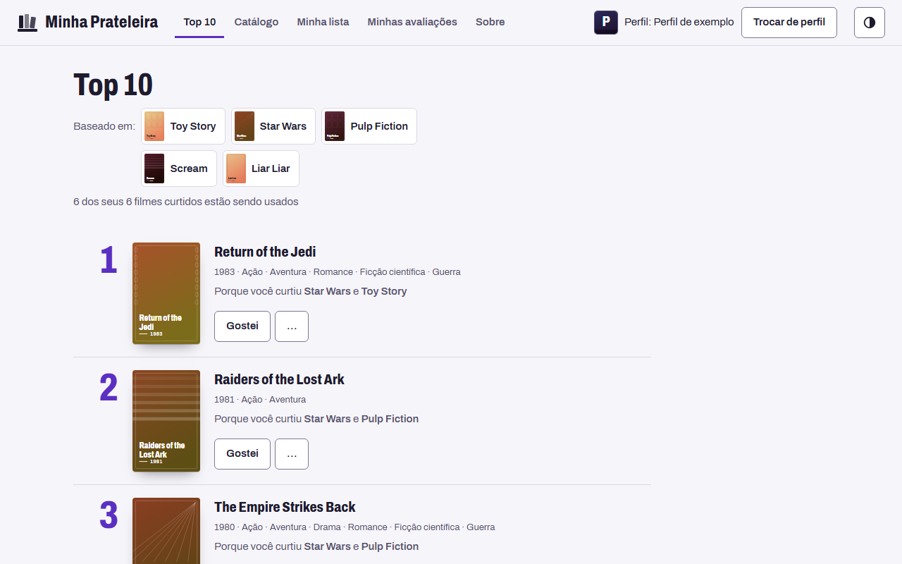

# Minha Prateleira

Aplicação local que recomenda filmes a partir das suas notas, usando a técnica S1 (filtragem colaborativa item a item, busca HNSW no pgvector) da pesquisa deste repositório. Tudo roda no seu computador: os perfis ficam só nele, sem senha, e nada é enviado a serviços externos.




As capturas em `docs/capturas/` são ilustrativas: usam só o perfil de exemplo, agregados do conjunto de dados e cartazes gerados localmente.

## Atribuição

Os dados vêm do MovieLens 100K, do GroupLens Research (Universidade de Minnesota). Este projeto não é endossado nem apoiado pelo GroupLens nem pela Universidade de Minnesota.

## Pré-requisitos

- Docker Desktop (Windows ou Mac) ou Docker Engine com Compose v2 (Linux). No Linux, recomenda-se Docker Engine 28 ou superior.
- Cerca de 3 GB livres em disco.
- Internet na primeira vez: cerca de 1 GB entre imagens e pacotes, mais 5 MB de dados. Depois funciona offline.

Não precisa de Node, de chave de serviço nem de arquivo `.env`.

## Instalação

```
git clone <URL do repositório no GitHub>
cd recomendacao-filmes/app
docker compose up --build
```

Abra http://localhost:3000. A página mostra o progresso da preparação; quando termina, a aplicação abre sozinha. O terminal imprime `Pronto: abra http://localhost:<porta>`.

**Tempo da primeira preparação.** Medições da Tarefa 16, feitas numa única máquina de desenvolvimento (Windows, Docker no WSL2, rede rápida); o seu tempo depende de internet e disco:
- construção da imagem sem cache de camadas: 25 s;
- instalação limpa a partir de um clone novo (volumes novos, com o cache de camadas já quente): build e subida em 31 s e aplicação operante em 37 s no total;
- primeiro `up` do Compose dos testes ponta a ponta, com build parcialmente frio: cerca de 1 minuto até operante.

Nas vezes seguintes a preparação leva poucos segundos. O registro do aceite manual (`docs/aceite-manual.md`) guarda os tempos medidos em outras máquinas.

## Tarefas comuns

Todos os comandos rodam dentro de `app/`.

- **Parar e retomar:** `Ctrl+C` e, depois, `docker compose up`.
- **Apagar tudo** (banco, dados baixados e perfis): `docker compose down -v`.
- **Refazer a preparação:** `docker compose run --rm preparar` e, depois, "Conferir de novo" na página.
- **Porta ocupada** (a padrão é a 3000), de três jeitos:
  - crie `app/.env` com `APP_PORTA=3001`;
  - no PowerShell: `$env:APP_PORTA=3001; docker compose up`;
  - no bash: `APP_PORTA=3001 docker compose up`.
- **Sem internet na preparação, com zip local:** baixe antes o `ml-100k.zip` do GroupLens e rode
  `ML100K_ZIP=/caminho/para/ml-100k.zip docker compose -f compose.yml -f compose.local-zip.yml run --rm preparar`
  (no PowerShell, defina `$env:ML100K_ZIP` antes). O caminho precisa ser um arquivo, não uma pasta. Sem `ML100K_ZIP`, o Compose recusa com a mensagem "defina ML100K_ZIP com o caminho do zip".

## Problemas comuns

- **Sem internet no build** (instalação de pacotes): o `docker compose up --build` falha no `npm ci`, com um erro de rede. A mensagem vem do npm ou do Docker e varia por sistema, então não é citada literalmente aqui; os sinais mais comuns são os códigos do npm `EAI_AGAIN` ou `ENOTFOUND` (para `registry.npmjs.org`) ou a falha de pull da imagem base (`node` ou `pgvector`). Conecte-se, ou configure o proxy do Docker, e rode de novo. O build precisa de internet; o zip local só resolve a preparação.
- **Sem internet na preparação:** a página mostra "A preparação falhou." com a causa
  `Não consegui baixar o MovieLens 100K (sem internet ou servidor fora do ar).`
  e o comando sugerido `docker compose -f compose.yml -f compose.local-zip.yml run --rm preparar`. Use o zip local acima.
- **Hash que não confere:**
  - na obtenção dos dados: `O arquivo <nome> baixado não confere com o usado na pesquisa.` (o arquivo baixado não é o usado na pesquisa; baixe o zip de novo, só do GroupLens);
  - na conferência do banco, a tela de bloqueio mostra causas como `treino do banco difere do congelado` ou `régua do banco difere da congelada`. Rode `docker compose run --rm preparar` e "Conferir de novo". Se persistir, `docker compose down -v` e recomece.
- **Credenciais:** `credenciais do banco não conferem; rode `docker compose run --rm preparar`` aparece quando as senhas do arquivo de estado e as do banco divergem. Rode o comando indicado. Se a mensagem for `O arquivo de credenciais está corrompido.`, apague o volume de estado com `docker compose down -v` (apaga tudo) e rode `docker compose up` de novo.
- **Outra preparação em andamento:** o log mostra `A preparação não começou: outra preparação em andamento`. Espere terminar; não rode dois `preparar` ao mesmo tempo.
- **Porta ocupada:** o Docker informa um erro de bind (porta em uso) ao subir o serviço `app`. O texto vem do Docker e varia por sistema: no Docker Engine/Compose costuma ser `Bind for 127.0.0.1:3000 failed: port is already allocated`; no Docker Desktop no Windows, com um processo do próprio computador ocupando a porta, a forma exata não foi confirmada aqui, e o sinal é o mesmo (falha de bind/porta em uso). Use `APP_PORTA`, como em "Tarefas comuns".

## Segurança

A aplicação publica a porta só em `127.0.0.1`. Não a exponha na rede (não troque o endereço de publicação, não use proxy reverso nem redirecione portas): ela não tem senha de perfil. No Linux, use Docker Engine 28 ou superior, que protege melhor as portas publicadas em loopback.

## Sobre os dados e o teste da pesquisa

A preparação baixa o `u1.base`, que contém as notas das quais o teste-2 da pesquisa foi derivado, e o lê inteiro; mas o teste-2 é separado em memória e retirado do treino, e os alvos escondidos nunca chegam à aplicação como gabarito: nada deles é gravado no banco nem no estado. O volume com os dados brutos só é montado no serviço de preparação, nunca no servidor.

## O que é igual à S1 avaliada e o que muda

É a mesma S1 da pesquisa: mesmos vetores (conferidos por hash), mesma busca com M = 300, os 150 primeiros e o top 10 como prefixo deles, completado pelos mais avaliados.

Muda só o **conjunto de exclusão**: no lugar dos filmes vistos no treino, saem das recomendações os filmes com qualquer interação do seu perfil, mais os filmes ocultos (o 267 e o gêmeo de maior id de cada par). Qualquer nota, "Gostei" ou "Quero assistir" tira o filme da lista; só "Gostei" e as notas 4 e 5 entram no seu perfil de gostos. Notas 1 a 3 ainda não afastam filmes parecidos.

O **índice HNSW é reconstruído** em cada instalação, com níveis aleatórios. Por isso a lista aproximada pode diferir, em casos raros, da que o índice da pesquisa daria; a fidelidade publicada entre HNSW e busca exata foi medida no índice da pesquisa.

## O que foi medido e o que não se transfere

A tela Sobre mostra os mesmos números. Os resultados são de uma avaliação retrospectiva: no teste-2 do Plano 3, 20% das notas dos usuários 1 a 462 foram escondidas; 462 foram considerados e 445 entraram na métrica (17 ficaram fora por não terem curtidas escondidas). Nesta avaliação retrospectiva, com essas 445 pessoas, a S1 teve NDCG@10 maior que a S2 (a configuração da v1, retreinada): diferença média de 0,0294, IC 95% [0,0136; 0,0458] por bootstrap pareado.

Isso **não** é desempenho com novos usuários. A qualidade medida (usuários históricos com pelo menos 20 notas) não se transfere para perfis novos. As notas avaliadas já pertenciam aos dados usados no projeto, ainda que isoladas no Plano 3: não é uma validação externa independente. Os níveis absolutos de NDCG não são comparáveis entre conjuntos de avaliação diferentes. O catálogo vai só até 1998.

## Licenças e dados

- Dados: MovieLens 100K, do GroupLens Research (Universidade de Minnesota), usados sob os termos de uso do GroupLens (uso não comercial, sem redistribuição, com citação). Este projeto não é endossado nem apoiado pelo GroupLens. Fonte: https://grouplens.org/datasets/movielens/100k/
- O repositório não redistribui os arquivos originais do MovieLens nem registros individuais (nenhuma avaliação individual, id de usuário histórico ou dado demográfico). A preparação baixa os dados do site do GroupLens para o seu computador.
- As capturas em `docs/capturas/` são ilustrativas, com valores agregados e só o perfil de exemplo. Isso é uma escolha de cautela do projeto; não se afirma que a licença autorize toda publicação de dados derivados.
- Cartazes: gerados localmente a partir do título e dos gêneros; não há imagens nem sinopses de terceiros.

Citação: F. Maxwell Harper and Joseph A. Konstan. 2015. The MovieLens Datasets: History and Context. ACM Transactions on Interactive Intelligent Systems (TiiS) 5, 4, Article 19. DOI: 10.1145/2827872

## Cartazes reais

Cartazes reais não estão disponíveis: nenhum fornecedor com licença compatível com um recomendador baseado em aprendizado de máquina foi encontrado (spec §11.2). Por isso a aplicação usa cartazes SVG gerados localmente.

## Modo de desenvolvimento

Desenvolvimento e testes usam o projeto Compose **`recomendacao-dev`**, declarado em `compose.dev.yml` (volume próprio; banco publicado em `127.0.0.1:5434`). O projeto `recomendacao-app` é a instalação real: nunca o use para testes nem rode `down -v` nele por causa de desenvolvimento.

As suítes de integração trocam as senhas dos papéis `app_leitura` e `app_escrita` no cluster do projeto `recomendacao-dev` (por isso nunca as aponte para a instalação real). Depois delas, rode a preparação de novo (`docker compose -f compose.yml -f compose.dev.yml run --rm preparar`) antes de usar o app de desenvolvimento.

```
docker compose -f compose.yml -f compose.dev.yml up -d db
npm test                  # unidade, isolamento e congelamento, sem banco
npm run test:web          # Vitest do frontend
npm run test:integracao   # com banco; exige ML100K_DIR
npm run e2e               # Playwright (Chromium e WebKit)
```

Nunca use `compose.override.yml`.

- **Integração:** `ML100K_DIR` aponta para a pasta com os 5 arquivos do MovieLens; sem ela os testes se ignoram. `APP_EXIGIR_DADOS=1` transforma essa ausência em falha (é o que o CI faz). Conexão: `TESTE_PGHOST`, `TESTE_PGPORT`, `TESTE_PGUSER`, `TESTE_PGPASSWORD`.
- **E2E:** `E2E_DOCKER` (padrão `docker`) e `E2E_COMPOSE_ARGS` dizem como alcançar o Compose que roda a aplicação (por exemplo, `E2E_DOCKER="wsl -d Ubuntu -- docker"`). `E2E_EXIGIR_SEGREDOS=1` faz a falta das senhas falhar a verificação de segredos (que usa captura em memória de requisições e respostas mais `docker compose logs`). `E2E_PERMITIR_BLOQUEIO=1` habilita o caso que adultera temporariamente o hash do treino no banco alvo para exercitar a tela de bloqueio.
- **Aviso:** nunca aponte `E2E_PERMITIR_BLOQUEIO` para a instalação real (`recomendacao-app`); use um projeto descartável. Se o processo morrer no meio, o banco fica com o hash adulterado: restaure com `docker compose run --rm preparar` e "Conferir de novo" (ou um `UPDATE` de `v2_final.metadados.hash_treino` para o valor congelado).
- O servidor de desenvolvimento do Vite faz proxy de `/api` para `http://localhost:3000`.

## Aceite manual

O roteiro e o modelo de registro estão em `docs/aceite-manual.md`.
