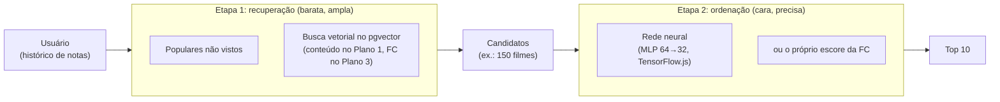

# 1. Visão geral

## O problema

Dado o histórico de notas de uma pessoa, quais 10 filmes ela ainda não viu e provavelmente vai gostar? Esse é o problema de **recomendação top-N**. O projeto o resolve com o [MovieLens 100K](https://grouplens.org/datasets/movielens/100k/), um conjunto público com **943 usuários, 1.682 filmes e 100.000 notas** (de 1 a 5) coletadas no fim dos anos 90.

O projeto foi desenvolvido na unidade de Deep Learning e Sistemas de Recomendação de uma pós-graduação. Ele tinha três objetivos de aprendizado, registrados no briefing inicial ([`docs/contexto-projeto.md`](../contexto-projeto.md)):

1. treinar uma **rede neural** que prevê se um usuário vai gostar de um filme;
2. guardar vetores num **banco vetorial** (Postgres com a extensão pgvector);
3. combinar os dois numa **arquitetura de duas etapas**: o banco recupera candidatos e a rede ordena só esses candidatos.

> O briefing é o ponto de partida, mas foi **superado pelas specs**. Ele fala em filtragem colaborativa por usuários e em precision@10. O projeto implementou filtragem colaborativa **item-item** e usou **NDCG@10** como métrica principal.

## A pergunta mudou ao longo do caminho

O projeto foi feito em três planos de pesquisa e depois virou uma aplicação. Cada plano partiu do resultado do anterior.

```mermaid
timeline
    title Linha do tempo do projeto (novembro de 2026)
    Plano 1 (fundação) : Ambiente, dados, régua de codificação : Vetores de conteúdo no pgvector + HNSW : Linha de base de popularidade e candidatos
    Plano 2 (rede neural) : Treino da rede com TensorFlow.js : Validação em 4 passos e congelamento : Avaliação única no u1.test (12/11)
    Plano 3 (filtragem colaborativa) : FC item-item no pgvector : Grade de 17 sistemas na validação : Avaliação retrospectiva no teste-2
    Aplicação (etapa 1) : Minha Prateleira, local, em Docker : Usa a S1 congelada (FC sozinha) : Testes de equivalência com a pesquisa
```

| Fase | Pergunta | Resposta (resumida) |
|---|---|---|
| **Plano 1** | Vetores de conteúdo (gênero, época, popularidade) ajudam a encontrar filmes relevantes? | Sozinhos, quase não acertam (NDCG@10 de 0,070 contra 0,233 da popularidade, na validação). Juntos com os populares, aumentam o recall dos candidatos. |
| **Plano 2** | Uma rede neural reordenando candidatos supera a popularidade? | **Sim.** No `u1.test`, NDCG@10 de 0,3526 contra 0,2451 (diferença +0,1076, IC 95% [0,0907; 0,1250]). Mas a configuração escolhida não usa os vetores de conteúdo: são 150 populares reordenados pela rede. |
| **Plano 3** | Filtragem colaborativa (FC) melhora a versão 1? A rede ainda acrescenta algo sobre a FC? | A FC sozinha (S1) superou a v1 (S2) no teste-2: +0,0294, IC 95% [0,0136; 0,0458]. A rede **sobre** a FC ficou abaixo da FC sozinha (−0,0234, descritivo). |
| **Aplicação** | Como usar o sistema vencedor no dia a dia? | Aplicação local que roda a S1 congelada, conferida por hash, sobre perfis criados pelo usuário. |

## A arquitetura em uma figura

A ideia central, que atravessa os três planos, é a **recomendação em duas etapas**:

- A **recuperação** reduz 1.682 filmes a algumas centenas. Ela precisa ter bom **recall**: um filme que não entra nos candidatos nunca será recomendado.
- A **ordenação** escolhe os 10 melhores entre os candidatos. Ela precisa de **precisão no topo**, que é o que o NDCG mede.

O sistema final da pesquisa (S1) usa a forma mais simples desse desenho: a busca colaborativa no pgvector já devolve os filmes em ordem, e o top 10 são os 10 primeiros. A rede neural, que foi central no Plano 2, perdeu para a FC no Plano 3. Esse resultado negativo é parte do trabalho, não uma falha dele: o capítulo 5 explica.

## O que torna o projeto diferente de um tutorial

Boa parte do código não é "fazer o modelo funcionar", e sim **garantir que a medição seja honesta**:

- **Separação estrita de dados.** Há fases (`exp`, `final`, `v2-exp`, `v2-final`) e cada uma só enxerga o que pode. O `u1.test` foi lido **uma única vez**; o Plano 3 nunca o leu.
- **Régua com hash.** Os parâmetros de codificação são calculados só com o treino e gravados com um sha256. Modelo, banco e aplicação recusam rodar com uma régua diferente.
- **Pré-registro e congelamento por git.** A configuração é escolhida na validação e commitada **antes** de olhar o teste. No Plano 3, até o hash das previsões foi commitado antes do gabarito.
- **Estatística pareada.** Toda comparação é feita usuário a usuário, com intervalo de confiança por bootstrap.
- **Limitações escritas.** O [registro completo da pesquisa](08-registro-completo.md) e o [README dos resultados](../../resultados/README.md) listam o que **não** foi medido e o que **não** se generaliza.

## Stack

| Camada | Tecnologia |
|---|---|
| Linguagem | Node.js 22 (ES modules) |
| Rede neural | TensorFlow.js (`@tensorflow/tfjs-node` 4.22) |
| Banco vetorial | Postgres 17 + pgvector 0.8.1, índice HNSW, via Docker no WSL2 |
| Testes | `node:test` (pesquisa e servidor), Vitest (front-end), Playwright (ponta a ponta) |
| Aplicação | Fastify (API), React + Vite (interface), Docker Compose |
| CI | GitHub Actions (`.github/workflows/app.yml`) |

Próximo: [2. Mapa do repositório](02-mapa-do-repositorio.md).
