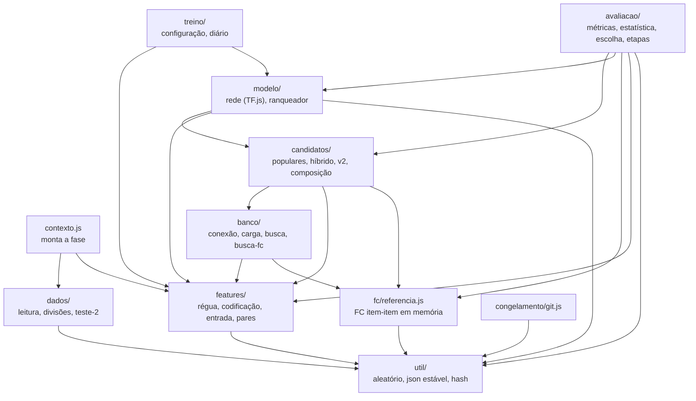
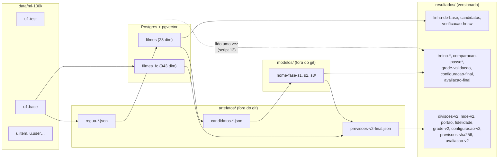

# 2. Mapa do repositório

## Visão de cima

```
recomendacao-filmes/
├── src/              biblioteca da pesquisa (funções puras + acesso ao banco)
├── scripts/          pontos de entrada numerados 01–23: cada um é um passo do experimento
├── tests/            testes da pesquisa (unidade e integração com o banco)
├── resultados/       saídas versionadas: os números que sustentam as conclusões
├── docs/             briefing, specs e planos (e este guia)
├── app/              a aplicação "Minha Prateleira" (preparação, servidor, web, testes)
├── data/             MovieLens 100K baixado            (fora do git)
├── artefatos/        réguas, candidatos e previsões    (fora do git)
├── modelos/          redes treinadas, 3 sementes cada  (fora do git)
├── docker-compose.yml  Postgres + pgvector da pesquisa (porta 5433)
└── package.json      os comandos npm run …
```

A regra que organiza tudo: **`scripts/` orquestra, `src/` calcula, `resultados/` registra**. Um script lê argumentos, monta o contexto da fase, chama funções de `src/` e grava um JSON em `resultados/` (ou em `artefatos/`, quando o arquivo é grande ou intermediário).

## Como os módulos de `src/` dependem uns dos outros

O diagrama mostra os imports entre as pastas de `src/` (extraídos do código). A seta `A --> B` quer dizer "A importa B".



Observações:

- **`util/` e `features/regua.js` são a base.** Quase tudo depende deles. A régua é o "dicionário" que traduz um filme ou usuário em números (capítulo 4).
- **`fc/referencia.js` não depende do banco.** Ele calcula a filtragem colaborativa em memória, em float64, e serve de gabarito para conferir a busca no pgvector. A própria `banco/busca-fc.js` usa a função de arredondamento dele (`escoreOficial`), para que o banco e a referência produzam o mesmo escore.
- **Dentro de `src/`, `modelo/rede.js` é o único arquivo que importa o TensorFlow.js.** A dependência nativa fica concentrada num só lugar (quem precisa da rede importa `modelo/rede.js` ou `modelo/ranqueador.js`, nunca o TensorFlow.js diretamente).
- **`avaliacao/` está no topo.** É onde tudo se junta para produzir números.

## `src/` arquivo por arquivo

### Dados e fases

| Arquivo | O que faz |
|---|---|
| `config.js` | Lê o `.env` (conexão do Postgres e pasta dos dados). Único lugar que acessa `process.env`. |
| `contexto.js` | **Ponto de entrada de quase todo script.** Dada uma fase (`exp`, `final`, `v2-exp`, `v2-final`), devolve o treino, os alvos (gabarito) e a régua daquela fase. Recusa combinações proibidas (ex.: ler o `u1.test` numa fase v2). |
| `dados/leitura.js`, `dados/carregar.js` | Leem os arquivos do MovieLens (`u.item` em latin-1, `u.user`, `u1.base`, `u1.test`). |
| `dados/divisoes.js` | Cria a **validação**: esconde 40% das notas dos usuários 463–943 (semente 42). |
| `dados/teste2.js` | Cria o **teste-2** do Plano 3: esconde 20% das notas dos usuários 1–462 dentro do `u1.base`. |
| `dados/estatisticas.js`, `dados/download.js` | Estatísticas simples para a EDA e download com conferência de hash. |

### Codificação (features)

| Arquivo | O que faz |
|---|---|
| `features/regua.js` | Calcula a **régua** a partir do treino: contagens de popularidade, mín/máx e média/desvio, pesos, médias de referência. Grava com hash sha256 e recusa uma régua alterada. |
| `features/codificacao.js` | Vetor de **busca** de 23 dimensões (19 gêneros + 3 épocas + 1 popularidade) para filmes, usuários e usuários novos. Contém o texto obrigatório sobre pesos e cosseno. |
| `features/entrada.js` | Vetor de **entrada da rede**, de 70 posições: demografia (24) + perfil do usuário (23) + filme (23). |
| `features/pares.js` | Monta os pares (usuário, filme, rótulo) do treino e da validação, com **amostragem de negativos** e correção de vazamento. |

### Candidatos

| Arquivo | O que faz |
|---|---|
| `candidatos/populares.js` | Ranking de popularidade e "populares não vistos". Com k = 10, é a linha de base. |
| `candidatos/hibrido.js` | Plano 1/2: une populares e vizinhos de conteúdo, registrando a fonte de cada filme. |
| `candidatos/arquivo.js` | Grava e lê as listas de candidatos em `artefatos/` com hash. |
| `candidatos/composicao.js` | Plano 3: compõe a lista exata (K populares + N da FC + preenchimento) e mede o **déficit**. |
| `candidatos/v2.js` | Plano 3: gera e grava as listas de candidatos da fase v2. |

### Banco (pgvector)

| Arquivo | O que faz |
|---|---|
| `banco/conexao.js` | Cria o pool de conexões do Postgres. |
| `banco/carga.js` | Recria a tabela `filmes` com os vetores de conteúdo e o índice HNSW, numa transação. Grava o hash da régua como "selo". |
| `banco/busca.js` | Busca os vizinhos de conteúdo (`ORDER BY embedding <=> vetor`), em modo HNSW ou exato. |
| `banco/carga-fc.js` | Recria a tabela `filmes_fc` com os vetores colaborativos (dimensão 943) e o índice HNSW. |
| `banco/busca-fc.js` | Busca colaborativa: confere os hashes, consulta o índice e resolve empates de forma determinística. **É usada pela aplicação.** |

### Modelo e treino

| Arquivo | O que faz |
|---|---|
| `modelo/rede.js` | Cria, treina (com parada antecipada), prevê, salva e carrega a rede. Pesos iniciais e embaralhamento são semeados. |
| `modelo/ranqueador.js` | Pontua os candidatos de um usuário com a rede e extrai o top 10 (empates pelo menor id). |
| `treino/configuracao.js` | Monta a configuração de treino do Plano 3 (pares, rede, épocas). |
| `treino/diario.js` | Acrescenta uma linha em `resultados/diario-treinos.jsonl` a cada treino. Um retreino fora do plano exige um `--motivo`. |

### Avaliação

| Arquivo | O que faz |
|---|---|
| `avaliacao/metricas.js` | NDCG@10, precisão@10, recall@10, cobertura e popularidade média. |
| `avaliacao/estatistica.js` | Erro padrão pareado, **bootstrap pareado** (5.000 reamostragens, semente 2026) e divisão mainstream × nicho. |
| `avaliacao/escolha.js` | **Regra de escolha**: a configuração mais simples dentro de 1 erro padrão da melhor. |
| `avaliacao/diagnosticos.js` | AUC da validação e correlação entre escore e popularidade. |
| `avaliacao/experimentos.js` | Roda os sistemas comparados (Plano 2) sobre um conjunto de usuários. |
| `avaliacao/mde.js` | Menor ganho detectável (MDE), por fórmula e por simulação. |
| `avaliacao/portao.js` | O "portão": a FC é boa o bastante como fonte de candidatos? |
| `avaliacao/fidelidade.js` | Compara a lista do HNSW com a busca exata e com a referência float64. |
| `avaliacao/sistemas-v2.js` | Define os sistemas S0–S4 do Plano 3. |
| `avaliacao/etapa1.js`, `avaliacao/etapa2.js` | Etapa 1: previsões e hash, **sem gabarito**. Etapa 2: lê o gabarito uma vez e calcula tudo. |
| `congelamento/git.js` | Confere commits, hashes de código e a ordem dos commits do protocolo. |

### Utilitários

| Arquivo | O que faz |
|---|---|
| `util/aleatorio.js` | Gerador pseudoaleatório **com semente**. Todo sorteio do projeto passa por ele, e é isso que torna os resultados reproduzíveis. |
| `util/json-estavel.js` | JSON com chaves ordenadas, para que o mesmo conteúdo dê sempre o mesmo hash. |
| `util/hash-avaliacoes.js` | Hash de um conjunto de notas (usado para provar que o treino é o esperado). |

## Quem grava e quem lê cada arquivo



O detalhe de cada script (o que lê, o que grava, em que ordem) está no [capítulo 3](03-pipeline-da-pesquisa.md). O significado de cada campo dos JSON está no [README dos resultados](../../resultados/README.md).

## `app/`: a aplicação

A aplicação tem sua própria organização, explicada no [capítulo 6](06-aplicacao.md). Em resumo:

| Pasta | Papel |
|---|---|
| `app/preparar/` | Roda uma vez (contêiner `preparar`): baixa os dados, confere hashes, reconstrói os vetores FC da fase `v2-final` e cria o schema `app`. |
| `app/servidor/` | API Fastify: rotas, pipeline da S1 (`recomendacao/s1.js`), segurança e o ciclo de estados. |
| `app/comum/` | Código compartilhado pela preparação e pelo servidor: conferência de integridade, gêmeos, títulos, estado. |
| `app/web/` | Interface React + Vite (telas e componentes). |
| `app/banco/migracoes/` | SQL do schema `app` (perfis, interações, filmes). |
| `app/testes/` | Unidade, integração, equivalência com a pesquisa, isolamento, congelamento e ponta a ponta. |
| `app/integridade.js` | As constantes congeladas: commits, hashes da régua, do treino e dos vetores FC, sha256 dos arquivos do MovieLens. |

**A aplicação importa código da pesquisa** (`src/banco/busca-fc.js`, `src/fc/referencia.js`, `src/contexto.js`, `src/candidatos/populares.js`) em vez de reescrevê-lo. É assim que ela garante usar exatamente a S1 avaliada.

## `docs/`: onde está o raciocínio

| Documento | Conteúdo |
|---|---|
| `docs/contexto-projeto.md` | Briefing inicial. Útil para entender a motivação; superado pelas specs. |
| `docs/superpowers/specs/2026-11-07-recomendacao-filmes-design.md` | Design dos Planos 1 e 2: vetores, rede, protocolo de validação, decisões rejeitadas. |
| `docs/superpowers/specs/2026-11-13-plano3-filtragem-colaborativa-design.md` | Design do Plano 3 (v4.3): FC, isolamento do teste-2, MDE, congelamento em duas etapas. |
| `docs/superpowers/specs/2026-11-16-aplicacao-etapa1-design.md` | Design da aplicação: arquitetura, API, segurança, critérios de aceite. |
| `docs/superpowers/plans/*.md` | Planos de implementação, tarefa por tarefa, de cada spec. |
| `app/docs/aceite-manual.md` | Roteiro e registro do aceite manual da aplicação. |

Próximo: [3. Pipeline da pesquisa](03-pipeline-da-pesquisa.md).
