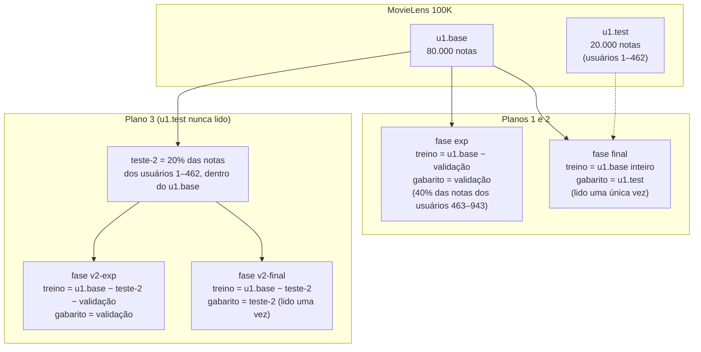
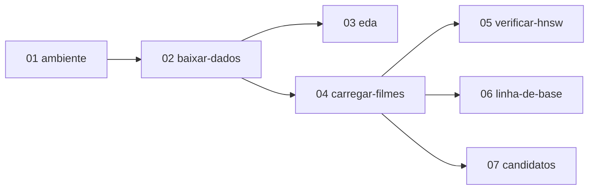
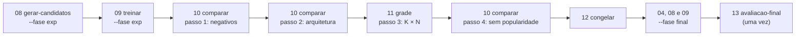
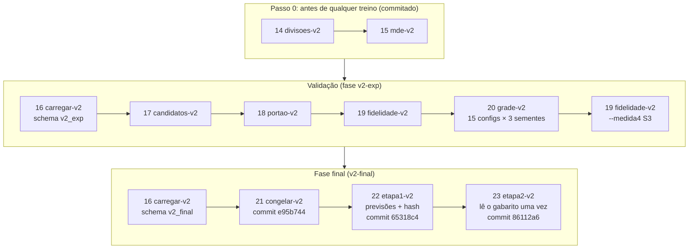

# 3. Pipeline da pesquisa

Os 23 scripts de `scripts/` são numerados na ordem em que rodaram. Cada um tem um comando `npm run` (ver `package.json`). Este capítulo mostra o fluxo, o que cada script lê e grava, e as **travas** que impedem rodar fora de ordem.

> Os comandos exatos, com todos os argumentos, estão no [registro completo da pesquisa](08-registro-completo.md). Aqui o foco é **entender** o encadeamento.

## Antes de tudo: as fases

Quase todo script começa com `criarContexto({ fase })` (`src/contexto.js`). A fase decide **com que dados o script treina e contra que gabarito ele mede**:

Por que tanta separação? Porque **cada decisão tomada olhando um gabarito "gasta" esse gabarito**. Se você escolhe a arquitetura olhando o teste, o número do teste deixa de ser uma estimativa honesta. A validação serve para escolher; o teste, para medir uma vez. Mais detalhes no [capítulo 4](04-fundamentos.md#11-vazamento-de-dados-e-a-disciplina-de-avaliação).

## Plano 1: fundação (scripts 01–07)

| # | Comando | Lê | Grava | Para quê |
|---|---|---|---|---|
| 01 | `ambiente` | `.env` | — | Confere TensorFlow.js e a conexão com o banco. |
| 02 | `baixar-dados` | internet (GroupLens) | `data/ml-100k/` | Baixa e extrai o MovieLens 100K. |
| 03 | `eda` | dados | só o terminal | Análise exploratória: distribuição de notas, gêneros, notas por usuário e por filme. |
| 04 | `carregar-filmes` | dados | `artefatos/regua-<fase>.json`, tabela `filmes` | Calcula a régua e grava os vetores de conteúdo (23 dim) com índice HNSW. |
| 05 | `verificar-hnsw` | banco, régua | `resultados/verificacao-hnsw.json` | Compara a busca aproximada (HNSW) com a exata. |
| 06 | `linha-de-base` | dados, régua | `resultados/linha-de-base-validacao.json` | Mede a popularidade (o número a superar). |
| 07 | `candidatos` | banco | `resultados/candidatos-validacao.json` | Mede o recall da grade K populares × N vizinhos. |

## Plano 2: rede neural (scripts 08–13)

| # | Comando | Lê | Grava | Para quê |
|---|---|---|---|---|
| 08 | `gerar-candidatos` | banco, régua | `artefatos/candidatos-<fase>.json`, `resultados/referencia-aleatoria.json` | Grava as listas de populares e vizinhos de cada usuário, com hash. |
| 09 | `treinar` | candidatos, régua | `modelos/<nome>-<fase>-s1..s3/`, `resultados/treino-<nome>-<fase>.json`, `resultados/diario-treinos.jsonl` | Treina a rede com 3 sementes. Na fase `final`, repete a melhor época de cada semente da `exp`. |
| 10 | `comparar` | modelos, candidatos | `resultados/comparacao-passo<N>.json` | Compara modelos na validação (passos 1, 2 e 4). |
| 11 | `grade` | modelos congelados | `resultados/grade-validacao.json` | Testa as combinações de K e N com os modelos já treinados. |
| 12 | `congelar` | resultados da validação | `resultados/configuracao-final.json` | Fixa a configuração **antes** de qualquer contato com o teste. |
| 13 | `avaliacao-final` | `u1.test`, modelos finais | `resultados/avaliacao-final.json` | Avaliação única. **Recusa sobrescrever** o arquivo. |

Como o script 09 nomeia os modelos: `<negativos>-<arquitetura>[-sempop]`, por exemplo `candidatos-64-32` ou `candidatos-64-32-sempop`. A pasta `modelos/` guarda uma subpasta por nome, fase e semente, cada uma com `model.json`, `weights.bin`, `regua.json` e `metadados.json`.

## Plano 3: filtragem colaborativa (scripts 14–23)

| # | Comando | Grava | Para quê |
|---|---|---|---|
| 14 | `divisoes-v2` | `resultados/divisoes-v2.json` | Registra os hashes e os resumos das divisões (validação e teste-2). |
| 15 | `mde-v2` | `resultados/mde-v2.json` | Pré-registra o **menor ganho detectável** antes de ver resultados. |
| 16 | `carregar-v2` | schemas `v2_exp` / `v2_final` (tabelas `filmes` e `filmes_fc`) | Um schema por fase, cada um com seus vetores e hashes. |
| 17 | `candidatos-v2` | `artefatos/candidatos-v2-<fase>.json`, `resultados/deficit-<fase>.json` | Listas de candidatos (populares + FC) e o déficit. |
| 18 | `portao-v2` | `resultados/portao-fc-v2-exp.json` | Filtro de viabilidade: a FC traz recall suficiente como fonte de candidatos? |
| 19 | `fidelidade-v2` | `resultados/fidelidade-fc-v2-<fase>.json` | Mede a diferença entre HNSW, busca exata e referência float64. |
| 20 | `grade-v2` | `resultados/grade-v2-exp.json`, `modelos/v2-<K>-<N>-v2-exp-s*` | Treina e avalia a grade de 15 configurações com rede, mais S0 e S1, e aplica a regra de escolha. |
| 21 | `congelar-v2` | `resultados/configuracao-v2.json` | Congela o sistema escolhido, as épocas e o **sha256 do código**. |
| 22 | `etapa1-v2` | `artefatos/previsoes-v2-final.json`, `resultados/previsoes-v2-final.sha256.json` | Gera as previsões do teste-2 **sem ler o gabarito** e grava o hash delas. |
| 23 | `etapa2-v2` | `resultados/avaliacao-v2.json` | Confere o hash das previsões, lê o gabarito uma vez e calcula as métricas. |

### Por que duas etapas no fim?

No Plano 2, a garantia de "olhar o teste uma vez" dependia da palavra de quem rodou. No Plano 3, o protocolo foi travado pela **ordem dos commits**:

1. `e95b744`: a configuração congelada (o que vai ser avaliado);
2. `65318c4`: o hash das previsões (o que o sistema recomendou), **antes** de ler o gabarito;
3. `86112a6`: o resultado.

Se alguém mudasse o sistema depois de ver o gabarito, o hash das previsões não bateria. O [registro completo da pesquisa](08-registro-completo.md) registra a ressalva: isso prova a **ordem**, não que houve uma única leitura, porque o repositório não tem âncora externa de tempo.

## Travas que impedem erros silenciosos

Vários scripts **recusam rodar** em vez de produzir um número errado:

| Trava | Onde | O que evita |
|---|---|---|
| Hash da régua no banco ≠ régua em uso | `banco/carga.js`, `banco/busca-fc.js` | Buscar vetores calculados com outra codificação. |
| Régua salva com o modelo ≠ régua em uso | `modelo/rede.js` (`carregarModelo`) | Usar uma rede com entradas de significado diferente. |
| Retreino sem `--motivo` | `scripts/09-treinar.js` + `treino/diario.js` | Retreinar até "dar certo" sem deixar registro. |
| Arquivo de resultado já existe | scripts 13, 21 e 23 | Reavaliar no teste depois de ver o número. |
| `incluirTeste` numa fase v2 | `src/contexto.js` | Ler o `u1.test` no Plano 3. |
| Nota escondida também no treino | `features/pares.js` | Vazamento entre treino e validação. |
| NDCG fora de [0,15; 0,35] | `scripts/10-comparar.js` | Um bug grosseiro passar despercebido (grava, avisa e sai com código 3). |

## Testes

| Comando | O que roda |
|---|---|
| `npm test` | `tests/unidade/*.test.js`, com dados sintéticos e sem banco. Inclui um teste estático de **isolamento** (os módulos do teste-2 não importam o que não podem). |
| `npm run test:integracao` | `tests/integracao/*.test.js`, contra o Postgres. Cria e apaga schemas temporários, sem tocar em `public.filmes`. |

A aplicação tem a própria bateria (capítulo 6), e o CI roda as duas.

Próximo: [4. Fundamentos teóricos](04-fundamentos.md).
