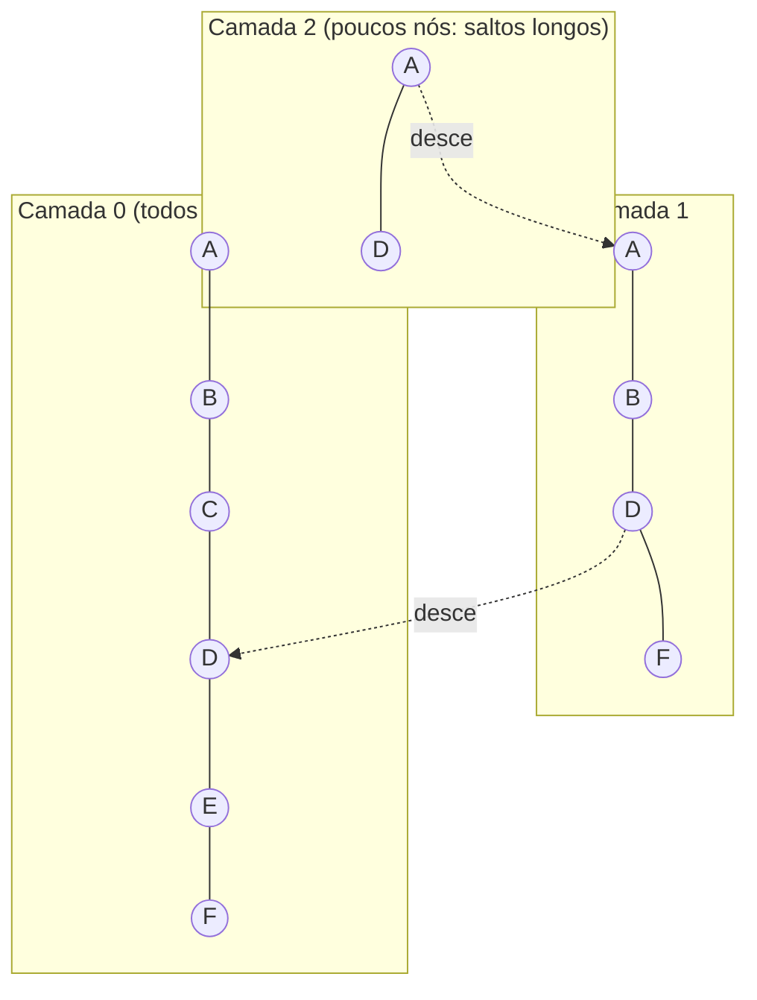
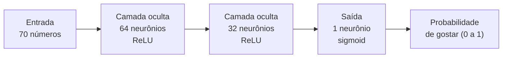

# 4. Fundamentos teóricos

Este capítulo explica, do zero, os conceitos usados no projeto. Cada seção termina com **"No projeto"**, que aponta onde o conceito aparece no código. Não é preciso saber Machine Learning para acompanhar; é preciso saber o que é uma média e um vetor (uma lista de números).

**Sumário**

1. [Recomendação top-N e o que conta como "gostar"](#1-recomendação-top-n-e-o-que-conta-como-gostar)
2. [Codificação: transformar filmes e pessoas em números](#2-codificação-transformar-filmes-e-pessoas-em-números)
3. [Vetores e similaridade de cosseno](#3-vetores-e-similaridade-de-cosseno)
4. [Banco vetorial: pgvector e o índice HNSW](#4-banco-vetorial-pgvector-e-o-índice-hnsw)
5. [Filtragem colaborativa item-item](#5-filtragem-colaborativa-item-item)
6. [Recomendação em duas etapas](#6-recomendação-em-duas-etapas)
7. [A rede neural (MLP)](#7-a-rede-neural-mlp)
8. [Amostragem de negativos](#8-amostragem-de-negativos)
9. [Métricas de ranking: precisão, recall e NDCG](#9-métricas-de-ranking-precisão-recall-e-ndcg)
10. [Estatística: comparar dois sistemas com honestidade](#10-estatística-comparar-dois-sistemas-com-honestidade)
11. [Vazamento de dados e a disciplina de avaliação](#11-vazamento-de-dados-e-a-disciplina-de-avaliação)
12. [Reprodutibilidade: sementes e hashes](#12-reprodutibilidade-sementes-e-hashes)

---

## 1. Recomendação top-N e o que conta como "gostar"

Há dois jeitos clássicos de formular recomendação:

- **Prever a nota** ("este usuário daria 3,7 a este filme"). Erros são medidos com RMSE.
- **Ordenar** ("estes são os 10 filmes mais indicados para ele"). É o **top-N**, e é o que um usuário de fato vê numa tela.

O projeto usa a segunda formulação. Para isso, transforma as notas em um sinal binário: **gostou = nota ≥ 4**. No MovieLens 100K, cerca de 55% das notas são 4 ou 5.

Essa escolha tem consequências que aparecem nas limitações: a nota 4 e a nota 5 viram a mesma coisa, e um filme com nota 2 vira "não gostou" do mesmo jeito que um filme nunca visto vira "desconhecido" (dois casos bem diferentes).

> **No projeto:** `nota >= 4` aparece em `features/regua.js`, `features/entrada.js`, `fc/referencia.js` e `avaliacao/metricas.js`. O gabarito de cada usuário é o conjunto de filmes **escondidos** com nota ≥ 4 (`relevantesPorUsuario`).

---

## 2. Codificação: transformar filmes e pessoas em números

Um modelo só entende números. Codificar é decidir **como** transformar "comédia de 1994 muito assistida" ou "mulher de 25 anos, estudante" em números. Os tipos de codificação usados:

| Técnica | Para quê | Exemplo |
|---|---|---|
| **One-hot** | Categoria com um único valor | Época: antes de 1980 → `[1,0,0]`; anos 80 → `[0,1,0]`; anos 90 → `[0,0,1]` |
| **Multi-hot** | Categoria com vários valores | Gêneros (19 posições): Toy Story → 1 em Animação, Infantil e Comédia |
| **Logaritmo** | Comprimir números muito desiguais | Popularidade: ir de 10 para 100 notas pesa parecido com ir de 100 para 1.000 |
| **Mín/máx** | Pôr um número entre 0 e 1 | `(x − mín) / (máx − mín)` |
| **Z-score** | Centrar em 0 com desvio 1 | `(x − média) / desvio`; 0 = típico, +1 = um desvio acima |

### A régua

Os parâmetros dessas transformações (mínimo, máximo, média, desvio, contagens de popularidade) **dependem dos dados**. Se forem calculados de novo na hora de recomendar, com dados um pouco diferentes, a posição 47 do vetor pode passar a significar outra coisa, e o modelo erra **sem dar erro**.

Por isso o projeto calcula esses parâmetros uma vez, só com o treino, e os grava num arquivo chamado **régua**, protegido por um hash sha256. Todo componente que codifica (banco, rede, aplicação) confere o hash antes de trabalhar.

> **No projeto:** `src/features/regua.js` (`calcularRegua`, `carregarRegua`). As réguas ficam em `artefatos/regua-<fase>.json` e são copiadas para dentro de cada modelo salvo.

---

## 3. Vetores e similaridade de cosseno

Depois de codificado, cada filme vira um **vetor**. No Plano 1, o vetor de busca de um filme tem 23 posições:

```
[ 19 posições de gênero | 3 de época | 1 de popularidade ]
```

O **perfil** de um usuário é a média dos vetores dos filmes que ele curtiu. Por exemplo, se 70% dos filmes curtidos são comédias, a posição "Comédia" do perfil vale 0,7. Assim, usuário e filme ficam no **mesmo espaço**, e dá para medir o quanto um se parece com o outro.

### O cosseno

A medida usada é a **similaridade de cosseno**: o cosseno do ângulo entre os dois vetores.

```
cos(u, f) = (u · f) / (‖u‖ × ‖f‖)
```

- `u · f` (produto escalar) soma os produtos posição a posição;
- `‖u‖` é o comprimento do vetor.

O resultado vai de −1 a 1 (de 0 a 1 quando os valores não são negativos). Vale 1 quando os vetores apontam na mesma direção. O cosseno **ignora o tamanho** do vetor e olha só a **proporção** entre as posições. Um usuário que curtiu 10 comédias e um que curtiu 100 têm o mesmo perfil de gênero.

### Pesos e por que "60/20/20" não quer dizer 60%

Cada bloco é multiplicado por um peso: gênero 0,6, época 0,2 e popularidade 0,2. Como o cosseno multiplica as posições dos dois vetores, **o peso entra ao quadrado**. Além disso, o bloco de popularidade não é normalizado como os outros, o que muda a sua participação no comprimento do vetor. A influência efetiva medida no projeto foi de **73,6% gênero, 14,4% época e 12,0% popularidade** (média sobre 10.418 pares usuário–filme relevante da validação). A explicação completa está no comentário obrigatório no topo de `src/features/codificacao.js`.

> **No projeto:** `features/codificacao.js` (`vetorBuscaFilme`, `perfilUsuario`, `vetorBuscaUsuario`, `vetorBuscaUsuarioNovo` para quem ainda não deu notas).

---

## 4. Banco vetorial: pgvector e o índice HNSW

O **pgvector** é uma extensão do Postgres que acrescenta o tipo `vector(n)` e operadores de distância. A consulta central do projeto é:

```sql
SELECT id FROM filmes
WHERE id <> ALL($excluidos)
ORDER BY embedding <=> $vetorUsuario   -- <=> é a distância de cosseno (1 − cosseno)
LIMIT 100;
```

### Busca exata × busca aproximada

Para achar os vizinhos mais próximos de forma **exata**, o banco compara o vetor com **todos** os filmes. Com 1.682 filmes, isso é instantâneo. Com milhões, não é.

O **HNSW** (*Hierarchical Navigable Small World*) é um índice que organiza os vetores num **grafo em camadas**: poucos nós nas camadas de cima, todos na de baixo. A busca começa no topo, dá saltos longos e vai descendo e refinando. É muito mais rápido, mas **aproximado**: às vezes deixa passar um vizinho verdadeiro.



Duas consequências que aparecem no projeto:

- **Fidelidade.** É preciso medir quanto a lista do HNSW difere da exata. No teste-2, o top 10 da S1 pelo HNSW foi **idêntico** ao da referência em 462 de 462 usuários.
- **Reprodutibilidade.** O pgvector sorteia o nível de cada nó ao construir o índice. Recarregar o banco pode mudar levemente os resultados baseados em HNSW, embora rodar de novo sobre a mesma carga dê sempre o mesmo resultado.

Com 1.682 filmes, o HNSW é **demonstrativo**: está ali para mostrar a arquitetura de produção, não por necessidade de velocidade.

> **No projeto:** `banco/carga.js` e `banco/carga-fc.js` criam os índices (`USING hnsw (embedding vector_cosine_ops)`); `banco/busca.js` e `banco/busca-fc.js` fazem as buscas nos modos `'hnsw'` e `'exata'`; `avaliacao/fidelidade.js` mede a diferença.

---

## 5. Filtragem colaborativa item-item

Os vetores de conteúdo (gênero, época) dizem **que tipo** de filme é, mas não **se é bom** nem **para quem**. A **filtragem colaborativa (FC)** ignora o conteúdo e usa só o comportamento: *"pessoas que gostaram dos filmes que você gostou também gostaram destes"*.

### O vetor de "fãs"

Na versão item-item usada no projeto, cada filme vira um vetor com **uma posição por usuário** (943 posições). A posição `u` vale 1 se o usuário `u` curtiu o filme (nota ≥ 4 no treino) e 0 se não curtiu. Depois, o vetor é normalizado (dividido pelo seu comprimento, `√número de fãs`).

Dois filmes são parecidos quando **têm os mesmos fãs**. O cosseno entre dois filmes `i` e `j` vale:

```
cos(i, j) = |fãs em comum| / ( √|fãs de i| × √|fãs de j| )
```

### Um exemplo pequeno

Quatro usuários e quatro filmes:

| | Usuário 1 | Usuário 2 | Usuário 3 | Usuário 4 |
|---|---|---|---|---|
| Matrix | ✓ | ✓ | ✓ | |
| Alien | | ✓ | ✓ | |
| Toy Story | ✓ | | | ✓ |
| Titanic | | | | ✓ |

Imagine uma pessoa nova, que curtiu só o **Matrix**. A pergunta é: **quais filmes têm fãs em comum com o Matrix?** Os fãs do Matrix são os usuários **{1, 2, 3}**. Cada filme candidato é comparado só com esse conjunto:

| Candidato | Fãs do candidato | Fãs em comum com o Matrix {1, 2, 3} | Cálculo | Escore |
|---|---|---|---|---|
| Alien | {2, 3} | {2, 3} → 2 | 2 / (√3 × √2) | **0,816** |
| Toy Story | {1, 4} | {1} → 1 | 1 / (√3 × √2) | **0,408** |
| Titanic | {4} | nenhum → 0 | 0 / (√3 × √1) | **0** |

O usuário 4 curtiu o Titanic e o Toy Story, então esses dois filmes têm um fã em comum **entre si**. Mas o usuário 4 não curtiu o Matrix, e por isso não liga o Titanic ao gosto dessa pessoa. O que importa é a sobreposição com os fãs dos filmes **que a pessoa curtiu**, não com os de qualquer filme.

No denominador, √3 vem dos 3 fãs do Matrix, e √2 ou √1 vem do número de fãs do candidato. Essa divisão **atenua** a vantagem de um filme com muitos fãs, mas não a elimina: um filme popular tende a ter mais fãs em comum com qualquer perfil, e o escore ainda cresce com a popularidade (ver o viés de popularidade nas limitações abaixo).

A recomendação seria Alien, depois Toy Story. O Titanic fica fora, porque só entram filmes com escore maior que zero. Se a pessoa também curtisse o Toy Story, o usuário 4 passaria a contar, e o Titanic ganharia um escore positivo.

### O perfil de quem curtiu vários filmes

O perfil do usuário é a **soma** dos vetores normalizados dos filmes que ele curtiu. O escore de um filme candidato é o cosseno entre esse perfil e o vetor do filme, arredondado a 6 casas (o **escore oficial**, para que banco e referência empatem da mesma forma). Os filmes já vistos são excluídos.

### Por que no banco vetorial

Como cada filme é um vetor de 943 posições, "achar os filmes mais parecidos com o perfil" é exatamente uma busca de vizinhos por cosseno. Por isso a FC do projeto roda **dentro do pgvector**, com índice HNSW, e não num cálculo em memória.

### Limitações (registradas no capítulo 8)

- **Não escala:** a dimensão do vetor é o número de usuários. Cabe no limite do HNSW (2.000), mas não serve para milhões de usuários. A evolução natural é a **fatoração de matrizes**, que gera vetores de tamanho fixo (ex.: 64).
- **Partida a frio:** um filme que ninguém curtiu não tem vetor (na fase `v2-final`, só 1.385 dos 1.682 filmes têm). Um usuário novo recebe recomendações na hora: o perfil dele é montado somando os vetores dos filmes que curtiu, sem precisar recalcular nada. Mas ele **não passa a fazer parte** dos vetores dos filmes. Numa FC em produção, isso aconteceria num recálculo periódico. Na aplicação deste projeto, **esse recálculo não existe**: os vetores ficam congelados ([capítulo 6](06-aplicacao.md#o-que-a-aplicação-não-aprende)).
- **Viés de popularidade:** filmes com muitos fãs tendem a ter mais fãs em comum com qualquer perfil.
- **Binário:** descarta a intensidade da nota.

> **No projeto:** `src/fc/referencia.js` é a implementação de referência em float64 (`construirFC`, `vetorFilme`, `perfilFC`, `rankingReferencia`); `banco/carga-fc.js` grava os vetores; `banco/busca-fc.js` faz a busca; na aplicação, `servidor/recomendacao/explicacao.js` usa a mesma conta (fãs em comum) para dizer **por que** um filme foi recomendado.

---

## 6. Recomendação em duas etapas

Rodar um modelo caro em todos os filmes, para todos os usuários, é lento. Sistemas reais separam o trabalho:

1. **Recuperação (candidate generation):** um método barato reduz o catálogo a algumas centenas de candidatos. O que importa aqui é o **recall dos candidatos**: a fração dos filmes relevantes que entrou na lista. Ele é o **teto** do sistema, porque o que não entra nunca será recomendado.
2. **Ordenação (ranking):** um modelo mais rico ordena só os candidatos. O que importa aqui é a qualidade no topo (NDCG).

No projeto, as fontes de candidatos foram:

- **Populares não vistos:** simples e surpreendentemente fortes no MovieLens;
- **Vizinhos de conteúdo** (Plano 1): os N filmes mais próximos do perfil pelos vetores de 23 dimensões;
- **FC** (Plano 3): os N filmes com maior escore colaborativo.

Um resultado didático do Plano 2: quando a rede ordenou **todos** os filmes não vistos (Exp. 6), o NDCG caiu de 0,353 para 0,264. A etapa de candidatos não é só uma otimização de velocidade; o resultado é compatível com ela funcionar também como um **filtro de qualidade**, embora o experimento não isole a causa da queda.

> **No projeto:** `candidatos/hibrido.js` (Plano 1/2), `candidatos/composicao.js` e `candidatos/v2.js` (Plano 3), `modelo/ranqueador.js` (ordenação pela rede).

---

## 7. A rede neural (MLP)

### O que ela recebe

Para cada par (usuário, filme), a rede recebe um vetor de **70 números**:

| Posições | Bloco | Conteúdo |
|---|---|---|
| 0–23 | Demografia (24) | idade em z-score, gênero (M/F), ocupação em one-hot (21) |
| 24–46 | Perfil do usuário (23) | média de gêneros, épocas e popularidade dos filmes curtidos |
| 47–69 | Filme (23) | gêneros, época e popularidade do filme do par |

A rede **não** recebe o escore da FC nem identificadores de usuário ou filme. Ela só vê atributos.

### Como ela calcula

É um **perceptron multicamadas (MLP)**, uma rede densa:



- Cada neurônio calcula uma soma ponderada das entradas e aplica uma **função de ativação**.
- **ReLU** (`max(0, x)`) permite à rede aprender relações não lineares, como "gosta de ficção científica **e** de filmes dos anos 80".
- **Sigmoid** espreme a saída entre 0 e 1, para ser lida como probabilidade.

### Como ela aprende

| Conceito | No projeto | O que significa |
|---|---|---|
| Função de perda | Entropia cruzada binária | Pune mais quando a rede tem certeza e erra. |
| Otimizador | Adam, taxa 0,001 | Ajusta os pesos na direção que reduz a perda, com passo adaptativo. |
| Lote (batch) | 256 pares | Os pesos são atualizados a cada 256 exemplos. |
| Época | Uma passada por todos os pares | Os pares são reembaralhados a cada época (com semente). |
| Parada antecipada | Paciência 3, teto 50 | Para quando a perda de validação não melhora por 3 épocas e **restaura os pesos da melhor época**. Evita decorar o treino (sobreajuste). |
| Sementes | 1, 2 e 3 | Cada configuração é treinada 3 vezes, com pesos iniciais diferentes, para medir a variação. |

Na fase final não há validação para decidir quando parar. Então cada semente treina **exatamente** a melhor época que teve na fase `exp`. Como o treino final tem cerca de 31% mais pares, a rede final dá cerca de 31% mais passos de gradiente. O [capítulo 8](08-registro-completo.md#por-que-o-treino-final-usa-épocas-fixas-e-o-que-isso-significa) discute essa escolha.

### Uma rede de classificação usada para ordenar

A rede é treinada para responder "gosta ou não?" (classificação binária), mas é usada para **ordenar**: os candidatos são classificados pela probabilidade prevista. É uma abordagem comum (*pointwise*). O detalhe importante é que **ser bom em classificar não garante ser bom em ordenar**, como mostra a seção seguinte.

> **No projeto:** `features/entrada.js` (os 70 números), `modelo/rede.js` (criação, treino, previsão, persistência), `modelo/ranqueador.js` (top 10).

---

## 8. Amostragem de negativos

Para aprender "gosta / não gosta", a rede precisa de exemplos dos dois tipos. Os **positivos** são fáceis: as notas ≥ 4. Os negativos são o problema: com 943 × 1.682 ≈ 1,6 milhão de pares possíveis e só 100 mil notas, quase tudo é "não visto". **Não visto não é "não gostou"**: a pessoa pode simplesmente não conhecer o filme.

A solução é **sortear** negativos. Para cada positivo, o projeto sorteia **4 filmes** que o usuário não avaliou e os rotula como 0. Também usa as notas de 1 a 3 como **negativos observados**.

### Uniforme × dos candidatos

Foram testados dois jeitos de sortear:

- **Uniforme:** os 4 negativos vêm de qualquer filme do catálogo.
- **Dos candidatos:** 3 dos 4 vêm da lista de candidatos do usuário (populares e vizinhos), e 1 vem do catálogo.

O sorteio uniforme produz negativos **fáceis**: um filme obscuro qualquer, que a rede aprende a descartar só por ser pouco popular. O sorteio dos candidatos produz negativos **difíceis** (*hard negatives*): filmes plausíveis, que a rede vai encontrar na hora de ordenar.

O resultado na validação ilustra bem a diferença entre classificar e ordenar:

| Negativos | AUC na validação | NDCG@10 na validação |
|---|---|---|
| Uniforme | **0,870** | 0,292 |
| Dos candidatos | 0,776 | **0,315** |

A rede com negativos uniformes **classifica melhor** (AUC maior), porque seus negativos de validação também são fáceis. Mas **ordena pior** os candidatos reais. O projeto escolheu pelos NDCG.

### Cuidados contra vazamento

Três detalhes de `features/pares.js` evitam que a rede "cole":

- No par positivo, o **perfil do usuário é calculado sem o próprio filme do par**. Senão, o perfil já conteria a resposta.
- A popularidade do filme no par desconta a nota do próprio usuário (contagem − 1), pelo mesmo motivo.
- Os 4 negativos sorteados usam **o mesmo perfil** do positivo a que estão ligados. Senão, a rede poderia aprender o atalho "perfil completo = negativo".

> **No projeto:** `features/pares.js` (`sortearNegativos`, `paresDeTreino`, `paresDeValidacao`); resultados em `resultados/comparacao-passo1.json`.

---

## 9. Métricas de ranking: precisão, recall e NDCG

Todas comparam o top 10 recomendado com o **gabarito**: os filmes escondidos que o usuário avaliou com nota ≥ 4.

### Precisão@10 e Recall@10

- **Precisão@10:** dos 10 recomendados, quantos estão no gabarito. 3 acertos → 0,3.
- **Recall@10:** dos filmes do gabarito, quantos apareceram no top 10. 3 acertos de 20 relevantes → 0,15.

Recall@10 é naturalmente baixo para quem tem dezenas de relevantes: só há 10 vagas.

### NDCG@10 (a métrica principal)

Precisão trata igualmente um acerto na 1ª e na 10ª posição. Para quem usa o sistema, não é igual: as primeiras posições são as que importam. O **NDCG** (*Normalized Discounted Cumulative Gain*) dá a cada acerto um valor que **cai com a posição**:

| Posição | 1 | 2 | 3 | 4 | 5 | 6 | 7 | 8 | 9 | 10 |
|---|---|---|---|---|---|---|---|---|---|---|
| Valor `1/log₂(pos+1)` | 1,000 | 0,631 | 0,500 | 0,431 | 0,387 | 0,356 | 0,333 | 0,315 | 0,301 | 0,289 |

- **DCG** soma os valores das posições com acerto.
- **IDCG** é o melhor DCG possível (todos os relevantes no topo).
- **NDCG = DCG / IDCG**, entre 0 e 1.

**Exemplo:** um usuário tem 3 filmes relevantes escondidos. O sistema acerta na posição 1 e na posição 4.

```
DCG  = 1,000 + 0,431            = 1,431
IDCG = 1,000 + 0,631 + 0,500    = 2,131   (3 acertos nas 3 primeiras posições)
NDCG = 1,431 / 2,131            ≈ 0,671
```

### Métricas de diversidade

- **Cobertura:** fração dos 1.682 filmes que aparece em pelo menos uma lista. A popularidade tem cobertura baixíssima (todos recebem quase a mesma lista).
- **Popularidade média:** média do número de notas dos filmes recomendados. Valor alto indica viés para os populares.

### Uma ressalva importante

Um filme recomendado que o usuário **nunca assistiu** conta como erro, mesmo que ele fosse gostar. Por isso essas métricas medem um **piso**: o que dá para comprovar com os dados históricos.

> **No projeto:** `src/avaliacao/metricas.js`. Médias são **por usuário**: um usuário com 3 relevantes pesa o mesmo que um com 50.

---

## 10. Estatística: comparar dois sistemas com honestidade

"O sistema B teve NDCG 0,35 e o A teve 0,25" não basta. Com outros usuários, a diferença poderia ser outra. O projeto responde a duas perguntas: **a diferença é distinguível do acaso?** e **qual o tamanho dela?**

### Comparação pareada

Os dois sistemas são avaliados **nos mesmos usuários**. Para cada usuário, calcula-se a diferença `NDCG(B) − NDCG(A)`. Trabalhar com diferenças por usuário elimina a variação "este usuário é fácil, aquele é difícil", que afeta os dois sistemas igualmente.

### Bootstrap e intervalo de confiança

O **bootstrap** estima a incerteza sem fórmulas:

1. sorteie, com reposição, uma amostra do mesmo tamanho a partir dos usuários;
2. calcule a média das diferenças nessa amostra;
3. repita 5.000 vezes;
4. o **intervalo de confiança de 95%** vai do percentil 2,5 ao percentil 97,5 dessas 5.000 médias.

Se o intervalo inteiro está acima de zero, a hipótese "B supera A" é **suportada**. No Plano 2: diferença +0,1076, IC [0,0907; 0,1250]. Não inclui o zero.

### Erro padrão e a regra de 1 erro padrão

O **erro padrão** da diferença média mede quanto ela oscilaria com outros usuários. A **regra de escolha** do projeto usa esse número:

1. a configuração com maior NDCG médio é a "melhor";
2. toda configuração cuja diferença para a melhor é **menor que 1 erro padrão** é considerada **empatada** com ela;
3. entre as empatadas, escolhe-se a **mais simples**, numa ordem definida antes (ex.: rede 64→32 antes de 128→64→32; menor lista de candidatos antes da maior).

É um critério para **escolher**, não um teste de equivalência. Ele protege contra preferir uma configuração complexa por uma vantagem que pode ser ruído.

### MDE: o menor ganho detectável

Antes de medir, vale perguntar: **com este número de usuários, que tamanho de diferença eu conseguiria detectar?** Esse é o **MDE** (*minimum detectable effect*), calculado para um poder de 80%. Se o MDE é 0,02 e a diferença real é 0,005, um resultado "não suportado" não quer dizer que os sistemas sejam iguais, só que o teste não tinha poder para ver. O Plano 3 **pré-registrou** o MDE antes da grade (0,0235 para S0 × S1).

### Confirmatória × descritiva

Uma comparação **confirmatória** foi definida antes de ver os dados e é a única que pode "confirmar" uma hipótese. As outras são **descritivas**: mostram com IC, mas não contam como descoberta, porque fazer muitas comparações aumenta a chance de achar uma diferença por acaso (o problema das **comparações múltiplas**). Cada avaliação final tem **uma** hipótese confirmatória: a do `u1.test` (Plano 2) e a do teste-2 (Plano 3). O Plano 1 foi exploratório.

> **No projeto:** `avaliacao/estatistica.js` (`bootstrapPareado`, `erroPadraoPareado`), `avaliacao/escolha.js` (`escolherConfiguracao`), `avaliacao/mde.js`.

---

## 11. Vazamento de dados e a disciplina de avaliação

**Vazamento** (*data leakage*) é quando informação do gabarito chega, por qualquer caminho, ao modelo ou às decisões. O resultado é um número otimista que não se repete no mundo real. O projeto trata três formas:

| Forma | Exemplo | Defesa no projeto |
|---|---|---|
| **Direta** | A nota escondida também está no treino | Divisões por semente; erro explícito em `paresDeValidacao` |
| **Pela codificação** | Popularidade calculada contando as notas escondidas | A régua usa **só** o treino da fase |
| **Pelas decisões** | Escolher a arquitetura olhando o teste | Validação para escolher, teste para medir **uma** vez; congelamento por git |

### Validação, teste e "gastar" um conjunto

- A **validação** pode ser olhada à vontade, mas cada escolha feita com ela a torna **otimista**. No Plano 3, a S1 teve NDCG 0,3721 na validação e 0,1562 no teste-2: os gabaritos têm tamanhos diferentes (cerca de 22 curtidas escondidas por usuário na validação, contra 7,8 no teste-2) e os usuários também são outros. Nenhuma causa da queda foi isolada; por isso os níveis absolutos não se comparam entre os dois conjuntos.
- O **teste** é olhado uma vez, com tudo congelado antes. É a estimativa sem esse viés.

### Avaliação retrospectiva

O teste-2 do Plano 3 é honesto quanto ao protocolo, mas **não é inédito**: as mesmas notas tinham sido usadas como treino no Plano 2, e a ideia de testar FC veio dos resultados do `u1.test`, que são dos mesmos usuários. Por isso o resultado é chamado de **avaliação retrospectiva com isolamento**, e não de validação externa independente.

---

## 12. Reprodutibilidade: sementes e hashes

Um número só tem valor se outra pessoa (ou você, daqui a um mês) consegue obtê-lo de novo. O projeto usa três ferramentas:

- **Sementes.** Todo sorteio passa por um gerador pseudoaleatório com semente fixa (`util/aleatorio.js`): divisões (semente 42), teste-2 (20.000.000), negativos, embaralhamento por época, pesos iniciais da rede, bootstrap (2026).
- **Hashes.** Um sha256 identifica conteúdos: a régua, o treino, os vetores FC, as listas de candidatos, os pares de treino, as previsões, o próprio código. Se o hash bate, o conteúdo é o mesmo.
- **JSON estável.** Para o mesmo conteúdo dar o mesmo hash, as chaves são gravadas em ordem (`util/json-estavel.js`).

Há limites conhecidos, documentados no [registro completo da pesquisa](08-registro-completo.md): o HNSW sorteia níveis ao ser construído, e um arquivo com fim de linha CRLF pode fazer a conferência do hash de código recusar num clone novo (recusa falsa, nunca aprovação falsa).

Próximo: [5. Experimentos e decisões](05-experimentos-e-decisoes.md).
