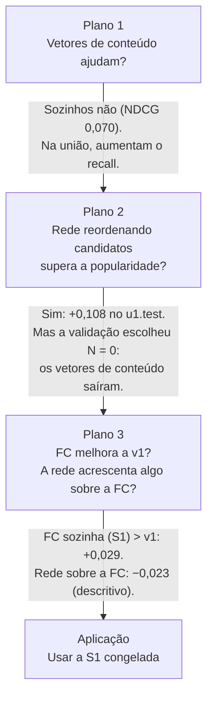

# 5. Experimentos e decisões

Este capítulo conta a história dos experimentos: a pergunta de cada etapa, o que foi medido, o que foi escolhido e por quê. Os números vêm de `resultados/`. Para o significado de cada campo, consulte o [README dos resultados](../../resultados/README.md); para os conceitos, o [capítulo 4](04-fundamentos.md).

---

## Plano 1: fundação e linha de base

**Pergunta:** os vetores de conteúdo no pgvector encontram filmes relevantes?

### A linha de base

Recomendar a cada usuário os 10 filmes mais populares que ele ainda não viu:

| Métrica (validação, 478 usuários) | Valor |
|---|---|
| NDCG@10 | **0,2330** |
| Precisão@10 | 0,2021 (cerca de 2 acertos em 10) |
| Cobertura | 0,0184 (só 31 filmes aparecem em alguma lista) |

Parece pouco, mas é uma **linha de base forte**: no MovieLens, as pessoas assistem e gostam muito dos mesmos clássicos.

### Vetores de conteúdo sozinhos

Recomendar os 10 vizinhos mais próximos do perfil (gênero, época, popularidade) deu **NDCG 0,070**. Gênero e época dizem "que tipo de filme", mas não "se é bom".

### Recall dos candidatos (grade K × N)

Como fonte de **candidatos**, os vetores acrescentam recall. Cada célula mostra o recall da união e o tamanho médio da lista:

| K populares \ N vizinhos | 0 | 20 | 50 | 100 |
|---|---|---|---|---|
| **50** | 0,323 · 50 | 0,364 · 68 | 0,405 · 97 | 0,462 · 144 |
| **100** | 0,462 · 100 | 0,491 · 117 | 0,523 · 144 | 0,567 · 189 |
| **150** | 0,577 · 150 | 0,600 · 165 | 0,622 · 191 | 0,656 · 234 |
| **200** | 0,647 · 200 | 0,665 · 213 | 0,683 · 238 | 0,712 · 279 |

**Leitura:** com o **mesmo tamanho de lista**, mais populares rendem mais recall do que vetores (K = 150 sem vetores: 0,577; K = 100 com N = 50, 144 candidatos: 0,523). Os vetores trazem filmes **diferentes**, mas não necessariamente **mais acertos**. A pergunta ficou para o Plano 2: a rede aproveita esses filmes diferentes?

---

## Plano 2: a rede neural

**Pergunta confirmatória:** o híbrido com rede (Exp. 4) supera a popularidade (Exp. 1) em NDCG@10 no `u1.test`?

### Validação: uma variável por vez

Em vez de testar todas as combinações (caro e propenso a escolher por acaso), a validação mudou **uma variável por passo**, mantendo as outras fixas:

| Passo | Variável | Resultado (NDCG@10 na validação) | Escolha |
|---|---|---|---|
| 1 | Negativos: uniforme × dos candidatos | 0,2922 × **0,3151** | **dos candidatos** |
| 2 | Arquitetura: 128→64→32 × 64→32 | 0,3151 × **0,3188** | **64→32**, que teve a maior média e também é a mais simples. A 128→64→32 ficou fora do empate (diferença de 0,0037, maior que 1 erro padrão, de 0,0030). A escolha foi marcada como "frágil" porque as faixas de resultado entre as sementes se sobrepõem. |
| 3 | Grade K ∈ {50…200} × N ∈ {0…100}, modelos congelados | N = 0 teve o maior NDCG | **K = 150, N = 0** |
| 4 | Controle: rede sem as entradas de popularidade | 0,3262 (com) × 0,3001 (sem) | registrado (descritivo) |

O passo 1 é o mais instrutivo do projeto: a rede com negativos uniformes tinha **AUC maior** (0,870 contra 0,776), mas **NDCG menor**. Classificar bem negativos fáceis não é o mesmo que ordenar bem candidatos plausíveis (capítulo 4, seção 8).

O passo 3 trouxe uma surpresa: a validação escolheu **N = 0**, ou seja, **nenhum vizinho de conteúdo**. A busca vetorial de conteúdo, um dos objetivos iniciais, não entrou no sistema escolhido.

### Congelamento

As escolhas foram gravadas em `resultados/configuracao-final.json` **antes** de qualquer contato com o teste: negativos dos candidatos, rede 64→32, K = 150, N = 0. Cada semente da fase final treinou a melhor época que teve na validação (modelo: 11, 15 e 15 épocas; controle: 15, 15 e 16).

### Avaliação final no `u1.test` (uma vez, em 12/11/2026)

456 usuários avaliados (os 459 do `u1.test` menos 3 sem nenhum relevante).

| # | Sistema | NDCG@10 | P@10 | Cobertura |
|---|---|---|---|---|
| 1 | Popularidade | 0,2451 | 0,2136 | 0,0303 |
| 2 | Só vetores de conteúdo | 0,0719 | 0,0643 | 0,2634 |
| 4 | **150 populares + rede** (hipótese principal) | **0,3526** | 0,3003 | 0,0947 |
| 6 | Rede sobre todos os não vistos | 0,2636 | 0,2173 | 0,1768 |
| 7 | Exp. 4 sem popularidade nas entradas (controle) | 0,3202 | 0,2709 | 0,1124 |

(Exp. 3 mede só os candidatos; Exp. 5 é idêntico ao 4 porque N = 0.)

**Hipótese principal:** diferença média por usuário de **+0,1076**, IC 95% **[0,0907; 0,1250]**. O intervalo não inclui o zero: **suportada**. As três sementes, isoladas, também excluem o zero.

**O que se aprende com os outros experimentos:**

- **A rede usa o gosto, não só a popularidade.** Sem as entradas de popularidade (Exp. 7), o NDCG cai para 0,320, mas fica bem acima dos 0,245 da popularidade.
- **Os candidatos funcionam como filtro.** A rede ordenando todos os filmes (Exp. 6) cai para 0,264.
- **Teto da rede:** só 57% dos relevantes estão entre os 150 candidatos. O resto, a rede nunca vê.
- **Média não é garantia individual:** 43 dos 456 usuários (9%) não têm nenhum acerto nas 3 sementes; na popularidade, são 99 (22%).

---

## Plano 3: filtragem colaborativa

**Perguntas:** (1) acrescentar FC melhora a v1? (2) Se sim, a rede ainda acrescenta algo sobre ela?

### Por que um "teste-2"

O `u1.test` já tinha sido lido. Ler de novo quebraria a promessa de uso único, e os outros conjuntos prontos do MovieLens (`u2`–`u5`, `ua`/`ub`) tinham notas já usadas em decisões. A solução foi esconder **20% das notas dos usuários 1–462 dentro do `u1.base`** e nunca usá-las no Plano 3. É uma avaliação **retrospectiva**: as notas eram novas para o Plano 3, mas não para o projeto (capítulo 4, seção 11).

### Passo 0: registrar antes de treinar

Antes de qualquer treino, foram commitados os hashes das divisões (`divisoes-v2.json`) e o **MDE** (`mde-v2.json`): 0,0235 para S0 × S1 e 0,0165 para S1 × uma heurística de FC.

### Os sistemas comparados

| Sistema | Candidatos | Ordenação | Treinado? |
|---|---|---|---|
| **S0** | — | popularidade | não |
| **S1** | 150 da FC (FC150) | escore da FC | **não** |
| **S2** (= v1) | 150 populares | rede | sim |
| **S3** | 150 da FC (FC150) | rede | sim |
| **S4-K-N** | K populares + N da FC | rede | sim |

A grade: K e N em {0, 50, 100, 150}, sem (0, 0). São 15 configurações com rede (incluindo S2 e S3), cada uma com 3 sementes, mais S0 e S1: **17 sistemas**.

### Portão: a FC serve como fonte de candidatos?

Com listas de 150, o recall médio dos candidatos foi 0,5815 só com populares, **0,6990** na melhor mistura (37 populares + 113 da FC) e **0,6946** só com FC. O portão passou. Ressalva registrada: o portão **já tinha sido visto numa prévia**, então não conta como pré-registrado.

### Escolha na validação e congelamento

A regra de 1 erro padrão, com uma ordem de simplicidade fixada antes, colocou **S1 primeiro**: zero parâmetros treinados por gradiente e nenhuma dependência de semente. A validação escolheu **S1 como v2**. Na validação, a S1 teve NDCG 0,3721 e a S2, 0,3113, mas esses números são **otimistas**: a mesma validação escolheu entre 17 sistemas e parou o treino das redes.

O congelamento (`configuracao-v2.json`) fixou o sistema, as épocas, as regras e o sha256 do código. O campo `desvios` ficou **vazio**: nada mudou depois do congelamento.

### Resultado no teste-2

445 usuários avaliados (462 menos 17 sem nenhuma curtida escondida).

| Sistema | NDCG@10 | P@10 | Cobertura | Popularidade média |
|---|---|---|---|---|
| S0 popularidade | 0,0962 | 0,0652 | 0,0220 | 347,3 |
| **S1 FC sozinha (v2)** | **0,1562** | 0,0975 | 0,1231 | 247,6 |
| S2 v1 | 0,1268 | 0,0867 | 0,1209 | 254,3 |
| S3 FC + rede | 0,1328 | 0,0903 | 0,2253 | 232,6 |
| S4-50-150 | 0,1327 | 0,0894 | 0,1887 | 240,5 |

**Comparação confirmatória (S1 − S2):** **+0,0294**, IC 95% **[0,0136; 0,0458]**. Suportada, com a ressalva de ser retrospectiva.

**Comparações descritivas** (com IC, mas não confirmatórias):

| Pergunta | Conta | Diferença | IC 95% |
|---|---|---|---|
| A FC ordena melhor que a popularidade? | S1 − S0 | +0,0600 | [0,0414; 0,0786] |
| A rede acrescenta algo à FC? | S3 − S1 | **−0,0234** | [−0,0401; −0,0072] |
| Os populares ajudam junto com a FC? | melhor S4 − S3 | −0,00002 | [−0,0062; 0,0059] |
| A FC melhora o sistema da v1? | melhor S4 − S2 | +0,0060 | [−0,0016; 0,0136] |

### Por que a rede perdeu para a FC

A rede do projeto vê **atributos** (demografia, gêneros, época, popularidade), mas **não vê o sinal colaborativo** ("quem gostou disto também gostou daquilo"). Sobre uma lista que a FC já ordenou bem, reordenar por atributos piorou o resultado. O [capítulo 8](08-registro-completo.md#limitações-do-plano-3) é preciso sobre o alcance disso: **não se testou uma rede que receba o escore da FC ou embeddings**. A conclusão vale para *esta* rede, *este* conjunto e *este* protocolo.

Também é importante o que os níveis absolutos **não** dizem: o NDCG do teste-2 (0,156) não é comparável ao do `u1.test` (0,353). O teste-2 tem em média 7,8 curtidas escondidas por usuário, contra cerca de 22 na validação. Com menos relevantes, o NDCG é naturalmente menor.

---

## Decisões rejeitadas (com evidência)

As specs registram alternativas consideradas e por que foram descartadas. Algumas das mais instrutivas:

| Proposta | Por que foi rejeitada |
|---|---|
| Treinar a rede só com positivos recuperados pelos candidatos | Perde 30% dos positivos, sobretudo de usuários de nicho; recomendações ficam mais populares. |
| Excluir dos negativos de treino os filmes da validação | Consulta informação escondida e infla o NDCG da validação em 0,009 a 0,014. |
| Ensemble das 3 sementes no sistema final | Seria um sistema novo, sem validação. As sementes são repetições do experimento. |
| Perfil completo também nos negativos sorteados | Cria o atalho "perfil completo = negativo". |
| Desempate pelo id dentro do SQL | Faz o pgvector abandonar o índice HNSW; o desempate é feito no código. |
| Usar `u2`–`u5.test` ou `ua`/`ub` no Plano 3 | Contêm notas já usadas em decisões ou no gabarito. |
| Validação cruzada em 5 dobras nos usuários 1–462 | Tiraria do treino metade dos usuários, justamente o que alimenta a FC. |
| Teste-2 com 40% das notas | O histórico dos usuários cairia demais; a perda de poder com 20% é tratada pelo MDE. |
| Escore da FC como entrada da rede | Exigiria um cálculo diferente do serviço do banco; ficou fora do prazo. |
| Ler o `u1.test` uma segunda vez | Quebra a promessa de uso único. |

Lista completa: §16 da [spec dos Planos 1 e 2](../superpowers/specs/2026-11-07-recomendacao-filmes-design.md) e §14 da [spec do Plano 3](../superpowers/specs/2026-11-13-plano3-filtragem-colaborativa-design.md).

---

## Metodologia de desenvolvimento assistido por IA

O projeto foi construído com assistentes de IA: specs e planos escritos com a IA e aprovados por mim, cada tarefa implementada por um subagente e conferida por outro, revisões externas e adversariais e portões humanos nos pontos críticos do protocolo. O processo, os papéis, exemplos reais do que as revisões encontraram e as limitações estão no [capítulo 9](09-metodologia-com-ia.md).

Próximo: [6. A aplicação](06-aplicacao.md).
