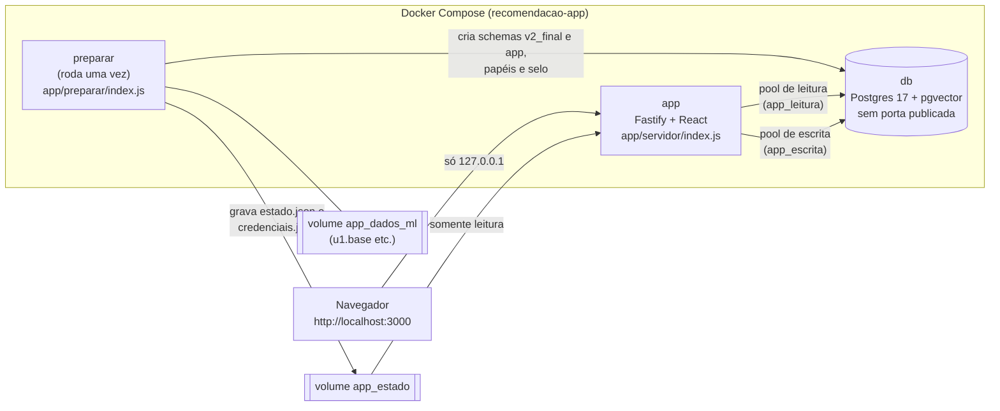
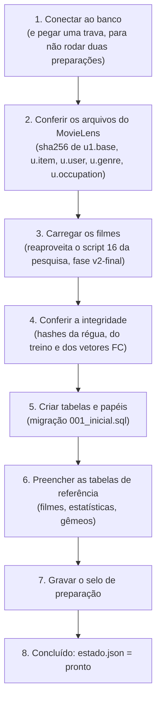
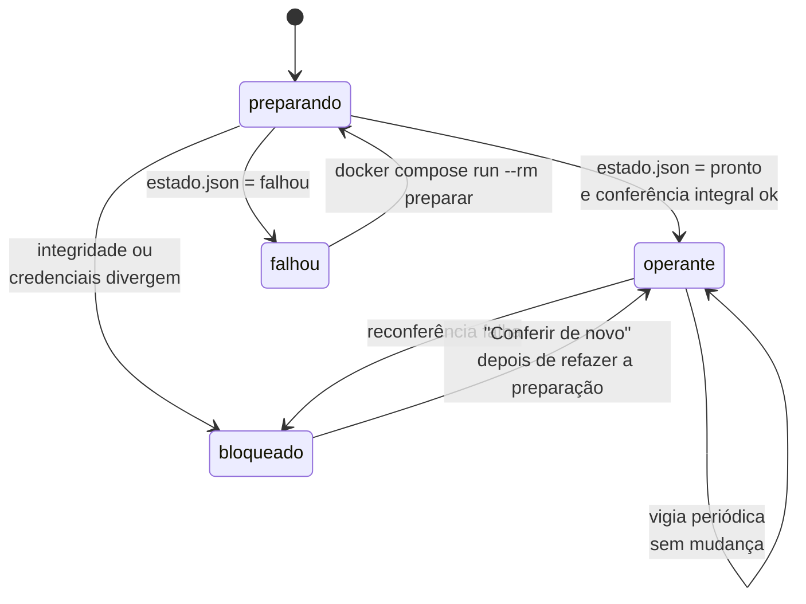
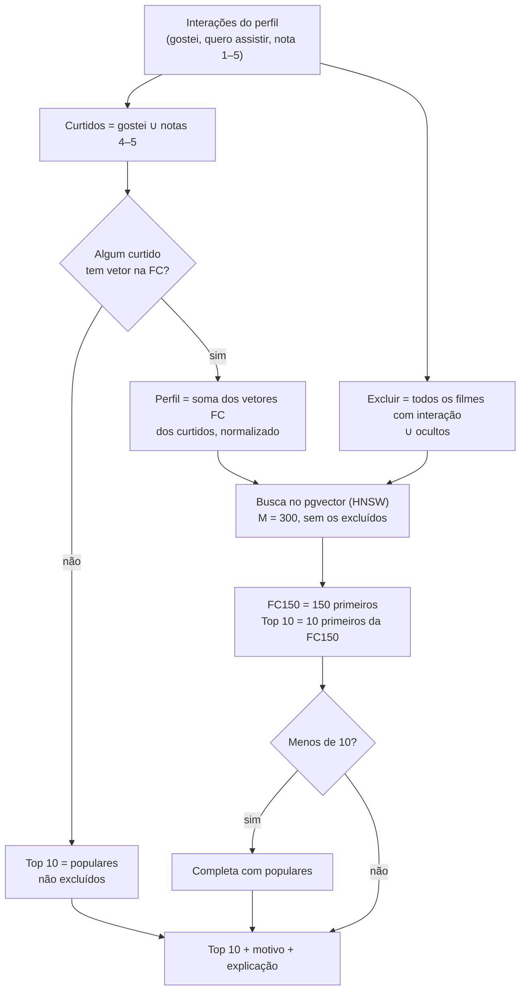
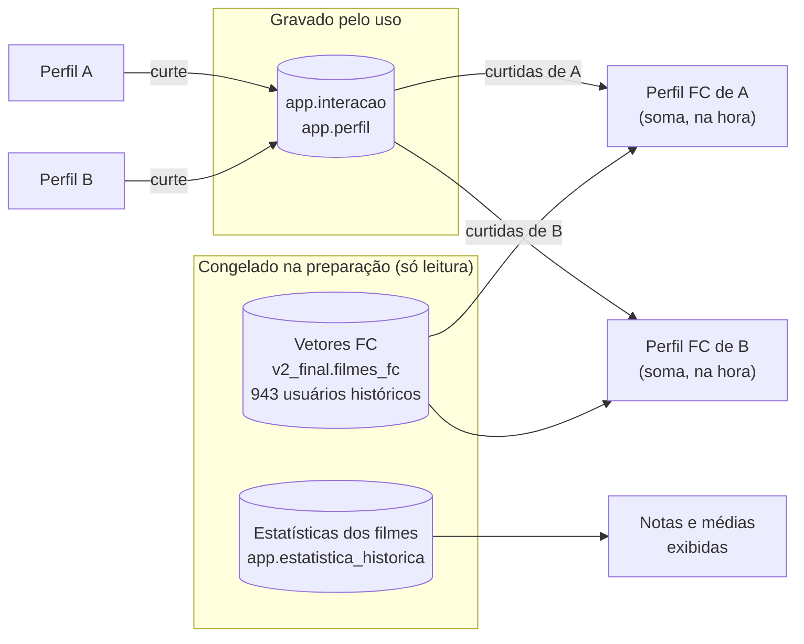

# 6. A aplicação "Minha Prateleira"

A pasta `app/` transforma o resultado da pesquisa numa aplicação que roda **no seu computador**. Você cria perfis, marca filmes de que gosta e recebe um top 10 calculado pela **S1** (filtragem colaborativa sozinha), o sistema escolhido no Plano 3.

Não há site público, por dois motivos: a licença do MovieLens 100K não permite redistribuir os dados, e os perfis devem ficar só na sua máquina. Para instalar e usar, veja o [README da aplicação](../../app/README.md). Este capítulo explica **como ela funciona por dentro**.

## O princípio: usar a pesquisa, não reimplementá-la

A aplicação **importa** o código da pesquisa (`src/banco/busca-fc.js`, `src/fc/referencia.js`, `src/contexto.js`, `src/candidatos/populares.js`) e confere, por hash, que os dados são os mesmos da avaliação. A ideia é que o número mostrado na tela "Sobre" descreva **o mesmo sistema** que está rodando.

| Igual à S1 avaliada | Diferente |
|---|---|
| Os vetores FC (conferidos pelo hash `vetoresFC`) | O **conjunto de exclusão**: em vez dos filmes vistos no treino, saem os filmes com qualquer interação do perfil e os filmes ocultos |
| A régua e o treino da fase `v2-final` (hashes) | O **índice HNSW** é reconstruído em cada instalação, com níveis aleatórios; em casos raros, a lista pode diferir da do índice da pesquisa |
| Busca única com M = 300, FC150 = os 150 primeiros, top 10 = os 10 primeiros, completado por populares | |

As constantes congeladas (commits, hashes, sha256 dos arquivos do MovieLens) ficam em `app/integridade.js`. Testes em `app/testes/congelamento.test.js` conferem que elas batem com os commits da pesquisa.

## Arquitetura

Três contêineres, definidos em `app/compose.yml`:

Pontos de projeto:

- **O servidor não monta os dados do MovieLens.** Só o contêiner `preparar` vê o volume com o `u1.base`. O servidor lê os vetores prontos no banco.
- **Dois papéis no banco.** `app_leitura` lê o schema `v2_final` (vetores da pesquisa); `app_escrita` grava perfis e interações no schema `app`. As senhas são geradas na preparação e nunca aparecem em logs.
- **O banco não publica porta.** E a aplicação publica a porta 3000 só no loopback (`127.0.0.1`). Ela não tem senha de perfil, então não deve ser exposta na rede.

## A preparação (contêiner `preparar`)

É idempotente: pode rodar quantas vezes for preciso. Os 8 passos aparecem na tela "Preparando…":

Os passos 5 a 7 rodam numa única transação. Se o banco já estiver preparado, a carga (passo 3) é pulada, e os arquivos do MovieLens só são conferidos quando ainda são necessários.

**Gêmeos e ocultos.** O MovieLens tem alguns filmes duplicados (mesmo título, ids diferentes) e um filme "unknown" (id 267). A preparação detecta os pares de títulos idênticos e esconde o filme 267 e o gêmeo de **maior** id de cada par (`app/comum/gemeos.js`).

## O servidor e seus estados

O servidor (`app/servidor/ciclo.js`) é uma pequena máquina de estados. Ele só responde recomendações quando tem certeza de que o banco é o congelado:

- Uma **vigia** tira periodicamente uma "impressão digital" barata do banco (a cada 60 s, por padrão). Se algo mudou, refaz a conferência completa.
- **Banco fora do ar não bloqueia**: o pedido recebe 503 `BANCO_INDISPONIVEL` e o servidor continua no estado em que estava.

## Como uma recomendação é calculada

O pipeline está em `app/servidor/recomendacao/s1.js` e segue a spec da aplicação (§4.4):

O resultado vem com um **motivo**, que a interface traduz em texto:

| Motivo | Quando |
|---|---|
| `personalizado` | Os 10 vieram da FC. |
| `parcial` | Parte veio da FC e parte dos populares. |
| `sem_curtidas` | O perfil ainda não curtiu nada. |
| `curtidas_sem_vetor` | Os filmes curtidos não têm vetor na FC (ninguém os curtiu no treino). |
| `sem_semelhantes` | A busca não achou nenhum filme com escore positivo. |

**Explicação "porque você gostou de…".** Para cada item da FC, a aplicação mostra até 2 filmes curtidos que **mais contribuem** para o escore dele, medidos pelo número de fãs em comum normalizado (`recomendacao/explicacao.js`). A conta é feita com inteiros, sem ponto flutuante, para ser determinística.

Note uma limitação herdada: **só "Gostei" e notas 4–5 entram no perfil**. Notas 1 a 3 tiram o filme da lista, mas não afastam filmes parecidos.

## O que a aplicação não aprende

A aplicação **não aprende com o uso**. Isso é intencional: assim ela roda exatamente a S1 que foi avaliada na pesquisa.

Na prática:

- **Um perfil não interfere no outro.** As curtidas são gravadas só em `app.interacao`. Na hora de recomendar, o perfil de cada pessoa é montado somando os vetores **congelados** dos filmes que ela curtiu. Se o perfil A curtir 50 filmes, o top 10 do perfil B não muda.
- **As estatísticas dos filmes não mudam.** O número de notas e a média exibidos vêm de `app.estatistica_historica`, que é preenchida na preparação com o treino da pesquisa e conferida contra a régua. Nenhuma rota do servidor escreve nessa tabela, nem nos vetores.
- **A popularidade também é histórica.** A lista de populares, usada para completar o top 10 e para perfis sem curtidas, vem dos mesmos dados de 1998.
- **Qualquer alteração nos vetores bloqueia o servidor.** A vigia acompanha o banco e, ao notar uma mudança, refaz a conferência dos hashes da régua, do treino e dos vetores FC. Se eles não baterem, o servidor entra em estado `bloqueado` em vez de recomendar com dados diferentes dos avaliados.

Fazer a aplicação aprender exigiria acrescentar os perfis locais aos vetores (eles ganhariam uma posição por perfil) e recalcular periodicamente. O sistema resultante já não seria a S1 avaliada, e os números da tela "Sobre" deixariam de descrevê-lo.

## API

Todas as rotas ficam sob `/api` e respondem JSON. Erros seguem o formato `{ codigo, mensagem }`.

| Método e rota | Para quê |
|---|---|
| `GET /saude` | Estado do servidor (preparando, operante, bloqueado, falhou) |
| `GET /perfis` · `POST /perfis` · `PATCH /perfis/:id` · `DELETE /perfis/:id` | Gerenciar perfis |
| `POST /perfis/exemplo` | Criar um perfil de exemplo |
| `GET /perfis/:id/onboarding` | Seleção inicial: os 2 filmes mais avaliados de cada gênero, depois os demais em páginas |
| `GET /perfis/:id/recomendacoes` | O top 10 |
| `GET /perfis/:id/interacoes` | Interações do perfil |
| `PUT /perfis/:id/interacoes/:filmeId` · `DELETE …` | Marcar ou desmarcar gostei, quero assistir ou nota |
| `GET /filmes` · `GET /filmes/:id` · `GET /generos` | Catálogo, detalhe e gêneros |
| `GET /sobre` | Números da pesquisa e avisos |
| `GET /diagnostico/busca` | Compara a lista HNSW com a busca exata para um perfil. Só existe com `APP_DIAGNOSTICO=1` |

**Segurança** (`app/servidor/seguranca.js`): lista de hosts permitidos (contra *DNS rebinding*), conferência de `Origin` nas escritas, corpo de até 4 KB, só JSON nas escritas e cabeçalhos de segurança (CSP) via Helmet.

## Interface (React + Vite)

| Rota | Tela | O que mostra |
|---|---|---|
| (sem perfil) | `TelaPerfis` | Escolher, criar ou renomear perfis |
| `/` | `Top10` | As recomendações, com motivo e explicação |
| `/onboarding` | `Onboarding` | Primeiros filmes para marcar |
| `/catalogo` | `Catalogo` | Busca por título, filtro por gênero e ordenação (mais avaliados, mais bem avaliados, título, ano) |
| `/filmes/:id` | `DetalheFilme` | Detalhe e controles de interação |
| `/minha-lista` | `MinhaLista` | Filmes marcados como "quero assistir" |
| `/minhas-avaliacoes` | `MinhasAvaliacoes` | Notas e curtidas |
| `/sobre` | `Sobre` | O que foi medido e o que **não** se transfere |

O estado da preparação aparece em `TelaPreparando` enquanto o servidor não está operante.

## Por que os cartazes são gerados localmente

Os "cartazes" da aplicação são desenhos SVG criados no próprio computador a partir do título e dos gêneros do filme. Não há imagens nem sinopses de terceiros, nem no repositório nem em tempo de execução. Foi uma **decisão de cautela sobre termos de uso**, registrada na §11.2 da [spec da aplicação](../superpowers/specs/2026-11-16-aplicacao-etapa1-design.md), e não uma limitação técnica.

**As fontes avaliadas e por que ficaram de fora:**

| Fonte | O que impediu o uso |
|---|---|
| **TMDB** (API) | Os termos de uso da API reservam ao TMDB o uso do conteúdo "em conexão com, ou para treinar" uma aplicação baseada em aprendizado de máquina ou inteligência artificial. A aplicação é um recomendador por filtragem colaborativa, uma técnica de aprendizado de máquina, e a restrição fala em "em conexão com", não só em treino. O projeto não presumiu exceção por ser acadêmico, não comercial ou por usar a chave da própria pessoa. **Foi enviado um pedido de esclarecimento ao TMDB, que não teve resposta** até a publicação desta documentação. |
| **Cinemeta / MetaHub** | Termos restritos ao Stremio, sem licença que autorize exibir as imagens. |
| **URLs de cartazes do IMDb** (conjunto `movielens-posters`, que associa os filmes do MovieLens a imagens hospedadas pela Amazon/IMDb) | Nenhuma licença de redistribuição. Carregar uma imagem não significa ter permissão para usá-la. |

**A investigação das URLs do IMDb mostrou também problemas de qualidade.** Ela foi feita à parte, fora deste repositório, sem baixar imagens nem fazer *scraping*:

- 1.592 dos 1.682 filmes têm URL de cartaz; 90 não têm nenhuma.
- Nas verificações visuais feitas (uma amostra aleatória de 50 filmes mais 6 conferências manuais), **35 cartazes estavam corretos, 3 eram de outro filme e 18 URLs não carregaram**. Na amostra de 50, 13 imagens eram pequenas demais para exibir bem.
- O identificador do IMDb **diverge** entre as fontes comparadas em 154 filmes.
- O MovieLens tem filmes diferentes com títulos parecidos (por exemplo, *La Promesse* e *Das Versprechen*), o que torna arriscado associar imagens automaticamente.

Ou seja, mesmo que a licença permitisse, usar essas URLs exigiria revisar manualmente centenas de filmes.

**Como isso pode mudar:** a aplicação tem uma interface para fornecedores de mídia (`app/servidor/midia/`). Um fornecedor de cartazes só entra se tiver uma licença **comprovadamente compatível** com um recomendador baseado em aprendizado de máquina, ou se o TMDB autorizar expressamente esse uso. Nenhuma das duas coisas aconteceu até agora.

> Este registro descreve a leitura cautelosa que o projeto fez dos termos de uso. Não é um parecer jurídico.

## O que os números da pesquisa dizem (e não dizem) sobre a aplicação

A tela "Sobre" mostra o resultado do teste-2: a S1 superou a S2 por 0,0294 de NDCG@10, IC 95% [0,0136; 0,0458]. Isso **não** é desempenho com novos usuários:

- foi medido com usuários históricos que tinham pelo menos 20 notas;
- as notas avaliadas já pertenciam aos dados do projeto (avaliação retrospectiva);
- o catálogo vai só até 1998.

## Testes da aplicação

| Comando (em `app/`) | O que roda |
|---|---|
| `npm test` | Unidade, **isolamento** (o servidor não lê dados da pesquisa que não deve), **congelamento** (constantes = commits da pesquisa) e fecho |
| `npm run test:integracao` | Integração com o banco e **equivalência com a referência** (a S1 da aplicação dá as mesmas listas que a referência da pesquisa) |
| `npm run test:web` | Componentes React (Vitest) |
| `npm run e2e` | Ponta a ponta com Playwright, em Chromium e WebKit |

No GitHub Actions (`.github/workflows/app.yml`), três jobs:

1. **testes**: unidade, web, integração e equivalência;
2. **congelamento da pesquisa**: confere que nada da pesquisa mudou e que as constantes batem com o commit `6077974`;
3. **instalação limpa**: sobe o Compose do zero, confere que a porta 5432 não é publicada, que a imagem não contém `.env` nem `resultados/`, que os hashes do log batem e roda o Playwright.

Próximo: [7. Glossário](07-glossario.md).
