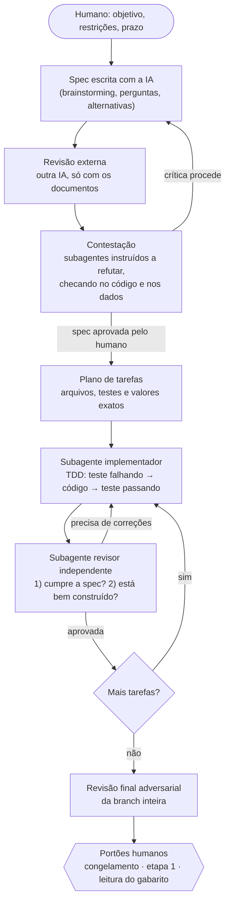

# 9. Metodologia de desenvolvimento com IA

O código, as specs e boa parte desta documentação foram escritos com assistentes de IA. Este capítulo descreve **como** isso foi feito: quem decidiu o quê, como o trabalho de uma IA foi conferido por outras e que controles impediram que um erro passasse despercebido. Ele também relaciona o processo a abordagens conhecidas e lista o que ele **não** garante.

## Como esta metodologia surgiu

Ela **não foi escolhida de antemão**. O processo cresceu na prática: cada etapa foi acrescentada quando um problema mostrou que ela fazia falta. Só depois, já no meio do Plano 3, perguntei a uma IA se a forma como eu estava trabalhando se encaixava em alguma metodologia existente. A resposta, conferida e resumida na seção [Conexões com abordagens conhecidas](#conexões-com-abordagens-conhecidas), é que o processo **combina práticas reconhecidas**, mas não segue nenhuma norma formal.

Uma descrição curta, só para dar nome ao que foi feito (não é um método formalizado nem uma certificação):

> **Desenvolvimento assistido por IA com revisão adversarial cruzada, validação iterativa e supervisão humana.**

## O fluxo

### Os papéis

| Papel | Quem | O que faz |
|---|---|---|
| **Responsável** | Humano | Define objetivo, restrições e critérios de aceite. Aprova specs e planos. Decide entre alternativas. **Autoriza os pontos críticos**: congelar a configuração, gerar as previsões finais e ler o gabarito. |
| **Agente controlador** | IA (sessão principal) | Conduz a execução do plano: distribui tarefas, agenda revisões e toma decisões operacionais (ordem das tarefas, aceitar ou não uma ressalva), registradas num diário de execução. |
| **Revisor externo** | Outra IA, consultada pelo humano | Lê **só os documentos** (spec e plano), sem acesso ao código. Procura falhas lógicas, estatísticas e de desenho, sem assumir que a proposta está certa. |
| **Contestadores** | Subagentes | Recebem as críticas externas com a instrução de **refutá-las ou confirmá-las com evidência** do código e dos dados, não por opinião. |
| **Implementador** | Subagente novo por tarefa | Lê o brief da tarefa e as restrições globais, escreve o teste que falha, implementa e entrega um relatório com a evidência. |
| **Revisor de tarefa** | Outro subagente | Confere o diff contra o brief e a spec. É instruído a **não confiar no relatório** do implementador. |
| **Revisores finais** | Subagentes adversariais | Revisam a branch inteira. No Plano 3 foram três, cada um com um foco (integridade, contratos e documentação); na aplicação, uma revisão final independente, só de leitura. |

### Regras que davam força às revisões

Algumas instruções dos arquivos de regras dos subagentes (fora do git, em `.superpowers/sdd/`), e alguns princípios do processo, fizeram diferença:

- **"Não confie no relatório."** O revisor trata o que o implementador diz como afirmação a verificar no diff. Justificativas de design nunca rebaixam a gravidade de um achado.
- **Evidência de TDD obrigatória.** O relatório precisa trazer a saída do teste **falhando** antes do código (RED) e **passando** depois (GREEN). Sem isso, a revisão aponta uma lacuna.
- **Divergências se resolvem por evidência, não por votação.** Quando duas IAs discordam, vale o que o código, os dados ou uma regra fixada antes mostram.
- **Restrições globais em arquivo.** Coisas como "nunca leia o `u1.test`" ficam num arquivo que todo subagente lê, e não dependem de cada um lembrar.
- **Na dúvida, parar.** O implementador deve reportar `NEEDS_CONTEXT` ou `BLOCKED` em vez de adivinhar uma decisão de arquitetura.

## O que veio pronto e o que foi acrescentado

A base do fluxo veio de uma ferramenta: o **[Superpowers](https://github.com/obra/superpowers)**, um conjunto de *skills* para o Claude Code criado por Jesse Vincent. É daí que vêm os nomes das pastas `docs/superpowers/` e `.superpowers/`. Ele fornece:

- *brainstorming*: refinar a ideia com perguntas e gerar a spec;
- *writing-plans*: quebrar a spec em tarefas pequenas, com arquivos, código e verificação;
- *subagent-driven-development*: um subagente novo por tarefa, com revisão em duas etapas (aderência à spec e qualidade de código);
- *test-driven-development*: o ciclo RED → GREEN.

Por cima dessa base, o projeto acrescentou:

| Acréscimo | Por quê |
|---|---|
| Revisão externa por **outra IA**, só com os documentos | Um segundo modelo, sem o contexto da conversa, tende a não compartilhar as mesmas suposições. |
| **Contestação** das críticas externas por subagentes | Nem toda crítica externa procede; as que procedem precisam ser provadas no código. |
| **Revisão final adversarial** com três focos | A revisão por tarefa não vê problemas que só aparecem na junção das partes. |
| **Portões humanos** ligados ao protocolo científico | As decisões que podem comprometer a avaliação não são delegadas. |
| **Controles técnicos**: hashes, ordem de commits, congelamento, testes de isolamento | Tornam verificável depois o que foi prometido antes (capítulos [3](03-pipeline-da-pesquisa.md#por-que-duas-etapas-no-fim) e [4](04-fundamentos.md#12-reprodutibilidade-sementes-e-hashes)). |

## Exemplos reais do que as revisões encontraram

Os registros completos estão em `.superpowers/sdd/`, que fica fora do git. Os casos abaixo foram conferidos nesses arquivos.

**1. Uma conclusão que podia ir além da evidência** (revisão final do Plano 3). O texto sobre S3 − S1 não deixava claro que a rede do projeto **não recebe o sinal colaborativo**, e o leitor poderia concluir que "redes neurais não acrescentam nada à filtragem colaborativa". O revisor de documentação pediu para descrever a rede como ela é: ela vê demografia, gêneros, época e popularidade, mas não o escore da FC nem embeddings. A frase foi reescrita para dizer o que foi medido (*esta* rede de atributos, reordenando a FC150) e que não se testou uma rede que receba o sinal colaborativo. O mesmo texto está hoje no [capítulo 5](05-experimentos-e-decisoes.md#por-que-a-rede-perdeu-para-a-fc).

**2. Um número usado como justificativa depois do fato** (mesma revisão). O README comparava o ganho observado no teste-2 (0,0294) com um MDE descritivo (0,0215), uma comparação que podia ser lida como justificativa do resultado. A spec dizia que esse MDE é só descritivo e "nunca justificativa do resultado". A comparação foi removida, e o texto passou a citar só os MDE **pré-registrados** (0,0235 e 0,0165).

**3. Uma garantia apresentada como mais forte do que era** (mesma revisão). O texto tratava como fato que o gabarito do teste-2 tinha sido lido uma única vez. O revisor apontou que a ordem dos commits (`e95b744` → `65318c4` → `86112a6`) prova a **ordem**, não que houve uma só leitura, porque o repositório não tem âncora externa de tempo. A frase passou a dizer "segundo o operador", com essa ressalva.

**4. Um CI que falharia no primeiro push** (revisão final da aplicação). O revisor reproduziu o CI num clone raso (`git clone --depth 1`) e viu os testes de congelamento falharem: 1 passou e 6 falharam. Eles precisam do histórico do git, e o checkout padrão do GitHub Actions só baixa o último commit. O pior era que, com esse passo falhando, os testes de integração e de equivalência **nem rodariam**. A correção foi usar `fetch-depth: 0` e acrescentar um teste que confere essa configuração em todo job que roda o congelamento.

**5. Um teste que mexia em coisa demais** (revisão da tarefa 11 da aplicação). Um teste de integração trocava a senha do papel `app_escrita` e derrubava suas conexões. Mas papéis do Postgres valem para o **cluster inteiro**, não só para o banco de teste: o teste derrubaria também as conexões do banco de desenvolvimento aberto na mesma instância. A mesma revisão apontou que faltava a evidência de RED no relatório.

Na etapa 1 da aplicação, das 12 revisões de tarefa e de integração registradas (tarefas 10 a 17 e integrações 2 e 3), **9 pediram correções** antes da aprovação.

## Conexões com abordagens conhecidas

Estas relações foram identificadas **depois**, como explicado no início. São inspiração conceitual e semelhança de estrutura, não conformidade com uma norma.

| Abordagem | Semelhança | Diferença |
|---|---|---|
| **Evaluator–Optimizer**, um dos padrões de fluxo descritos pela Anthropic em [*Building effective agents*](https://www.anthropic.com/research/building-effective-agents) (2024) | Um modelo produz, outro avalia e devolve críticas, em ciclo, até atingir um critério. É o par implementador ↔ revisor. | Aqui o critério de parada é a aprovação do revisor **e** os testes, não uma nota do avaliador. |
| **Multiagent Debate**: Du et al., *Improving Factuality and Reasoning in Language Models through Multiagent Debate*, ICML 2024 ([PMLR 235](https://proceedings.mlr.press/v235/du24e.html)) | Várias instâncias de modelo contestam as respostas umas das outras para achar erros. | No artigo, os agentes debatem até convergir numa resposta. Aqui não há busca de consenso: quem decide é a evidência ou o humano. |
| **Human-in-the-Loop** | As decisões críticas ficam com uma pessoa. | Aqui o humano não revisa cada linha. Ele aprova specs e planos e autoriza os pontos irreversíveis do protocolo. |
| **Verificação e Validação (V&V)**, como na norma IEEE 1012 (edição atual: 1012-2024) | Testes, inspeções, rastreabilidade de requisitos e análise de evidências ao longo do ciclo. | Não houve plano formal de V&V, níveis de integridade nem revisores **organizacionalmente** independentes. |
| **Revisão adversarial / falsificacionismo** | Procurar o caso que derruba a conclusão, e não só provas a favor. | — |

## O que este processo não garante

- **Concordância entre IAs não é prova de correção.** Modelos podem compartilhar os mesmos erros, vieses e suposições.
- **Independência funcional não é independência organizacional.** Os revisores são subagentes com contexto separado, não uma equipe externa.
- **Revisão não substitui execução.** Testes rodados, reprodutibilidade e avaliação em dados não usados para escolher continuam necessários. Os números do projeto vêm dos arquivos de `resultados/`, não de relatórios de agentes.
- **Não há replicação independente.** Ninguém de fora reproduziu os resultados.
- **Não se mediu se o processo funciona.** Os exemplos acima mostram que as revisões acharam problemas reais, mas não dizem quantos problemas passaram nem se outro processo acharia mais. Isso exigiria um estudo controlado.
- **Parte do registro não está no repositório.** O diário de execução e os relatórios de cada tarefa ficam em `.superpowers/`, fora do git.
- **A responsabilidade é do autor humano.** As decisões e os eventuais erros são meus, não das ferramentas.

## Se você quiser usar algo parecido

Para quem está começando a desenvolver com IA, as práticas que mais renderam neste projeto, em ordem de custo:

1. **Escreva uma spec antes do código** e peça à IA que liste alternativas e o que pode dar errado.
2. **Peça a outra IA**, numa conversa nova e só com os documentos, para criticar a spec. Depois cobre evidência das críticas.
3. **Quebre o trabalho em tarefas pequenas**, cada uma com o teste que prova que ela está pronta.
4. **Exija o teste falhando antes do código.** É a forma mais barata de saber que o teste testa alguma coisa.
5. **Revise o trabalho de uma IA com outra instância** instruída a desconfiar do relatório.
6. **Guarde para você as decisões irreversíveis** e registre-as no git antes de olhar o resultado.

## Referências

- Schluntz, E.; Zhang, B. *Building effective agents*. Anthropic, dez. 2024. https://www.anthropic.com/research/building-effective-agents
- Du, Y.; Li, S.; Torralba, A.; Tenenbaum, J. B.; Mordatch, I. Improving Factuality and Reasoning in Language Models through Multiagent Debate. *Proceedings of the 41st International Conference on Machine Learning*, PMLR 235:11733–11763, 2024. https://proceedings.mlr.press/v235/du24e.html
- IEEE. *IEEE Std 1012-2024: Standard for System, Software, and Hardware Verification and Validation*. https://standards.ieee.org/ieee/1012/7324/
- Vincent, J. *Superpowers*: skills para agentes de programação. https://github.com/obra/superpowers
